# Local harness: solution description

| Field | Value |
|---|---|
| Status | current |
| Date | 2026-11-13 |
| Version | 2.6.0 |
| Scope | local multi-agent harness (feature + bugfix workflows) + pilot "Mini-CRUD service" |
| Requirements source | [`requirements/initial.txt`](../../requirements/initial.txt) |
| Process rules | [`harness/process.md`](../../harness/process.md) |
| Board | [`docs/plan.md`](../plan.md) |
| HTML version | [`index.html`](index.html) |

This document describes the solution end to end: purpose, architecture, scenario
map, sequence diagrams for each scenario, the conceptual class model, the
architecture-design artifact package (component, scenario sequence, data,
class, per-service swimlane diagrams and OpenAPI 3.x specifications), and the
pilot case that confirmed the full cycle. All diagrams are embedded in the text;
the PlantUML source is linked next to each one.

---

## 1. Purpose and scope

A local harness is needed for designing solution and software architecture and
then implementing it. The process is performed by different roles within
individual tasks and a shared plan: tasks have dependencies, statuses, an
owning role, and acceptance criteria. Each role is a separate sub-agent running
on a local Ollama model; external APIs are not used.

The solution covers:

- harness: roles, two workflows, board, task/bug cards, checkpoints, process
  rules, commands, artifacts;
- local models and tools: Ollama, `local-rag`, MCP `plantuml-render`, Git;
- feature flow: requirements -> `UC-E2E-NNN` -> YAML data -> automated tests ->
  QA coverage/verdict;
- bugfix flow: `BUG-XXX` report -> reproduction + failing regression -> minimal
  fix -> independent QA fail-before/pass-after -> closure/postmortem;
- UX flow: user flows -> screens -> wireframes -> UI spec -> per-scenario HTML
  prototype (`UC-E2E-NNN` pages, optional coder implementation);
- the pilot "Mini-CRUD service" as an end-to-end example: requirements -> ADR ->
  diagrams -> QA acceptance.

Out of scope: authentication, external integrations, production deployment,
multi-user operation, pagination, and note search.

### Key principles

1. **Single board** - `docs/plan.md` is the only execution queue for both workflows.
2. **Single shared process** - `harness/process.md` defines shared rules;
   `harness/workflows/feature.md` and `bugfix.md` define stages and gates.
3. **One active task** - feature and bugfix never run in parallel and cannot
   preempt each other.
4. **Role isolation** - each role writes only to its area and stays within task
   boundaries; cross-role calls and grandchildren are forbidden, except
   `ux-designer -> harness-coder` for prototype pages. `harness-analyst` and
   `harness-coder` may spawn self-sub-sessions of their own role for chunked work
   (depth 2, sequential).
5. **Deterministic acceptance** - a task closes only by the card's `acceptance`
   criteria and explicit `CP-F` approval; failure is recorded in `Blockers`.
6. **User control** - every task stops at checkpoints; user edits and decisions
   are authoritative.
7. **Evidence first** - feature e2e traceability and bugfix fail-before/pass-after
   evidence are mandatory gates, not optional notes.
8. **Separate registries** - product defects in `docs/bugs/`, harness problems in
   `docs/issues/`.
9. **Locality** - models, embeddings, diagram rendering, and tests run locally.
10. **Traceability** - decisions, diagrams, contracts, reviews, and commits are
    linked through task and bug IDs.
11. **Derived visualization** - `docs/activity.puml/.svg` reflects the plan but
    is never a status, dependency, acceptance, or routing source; plan/cards win.

---

## 2. Architecture

### 2.1 Component diagram

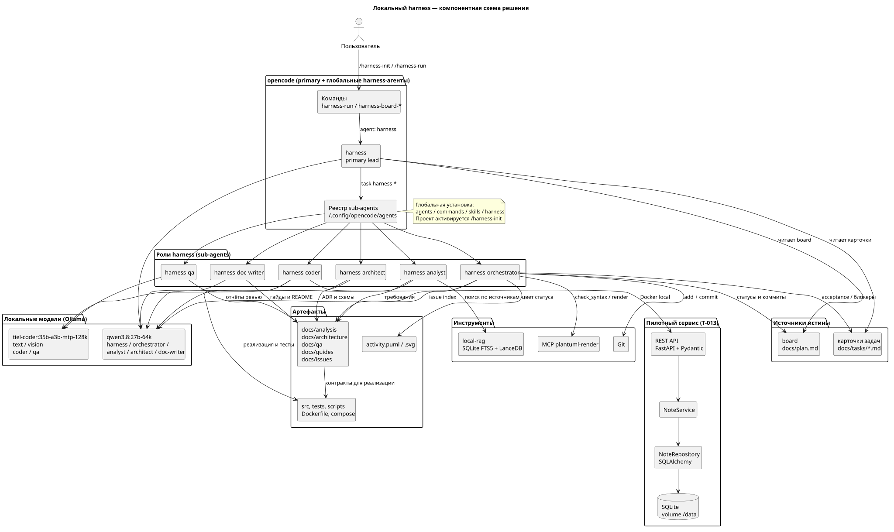

Source: [`diagrams/components-harness.puml`](diagrams/components-harness.puml).

Solution layers:

| Layer | Components | Purpose |
|---|---|---|
| Control | opencode, primary agent `harness`, `/harness-*` commands, global installation | explicit start, workflow routing, artifact sync |
| Workflows | `feature`, `bugfix`, bug registry | stage gates, regression evidence, escalation |
| Roles | `harness-orchestrator`, `harness-analyst`, `harness-ux-designer`, `harness-architect`, `harness-coder`, `harness-qa`, `harness-qa-vision`, `harness-doc-writer` | work within responsibility areas |
| Models | `qwen3.8:27b-64k`, `tiel-coder:35b-a3b-mtp-128k-text`, `tiel-coder:35b-a3b-mtp-128k-vision` | local inference without external APIs |
| Sources of truth | `docs/plan.md`, `docs/tasks/*.md`, `docs/bugs/*.md`, `docs/checkpoints/*.md` | work scope, statuses, defects, acceptance, user decisions |
| Artifacts | `docs/analysis`, `docs/ux`, `docs/architecture`, `docs/qa`, `docs/guides`, `docs/issues`, `src`, `tests` | role results |
| Tools | MCP `plantuml-render`, `local-rag`, Git | diagram validation/rendering, source search, versioning |
| Pilot | FastAPI REST API, NoteService, NoteRepository, SQLite | end-to-end implementation example |

Control flow: the user calls `/harness-feature`, `/harness-bug`, or
`/harness-run T-XXX` -> the command switches the session to the primary agent
`harness` -> the lead checks the marker, workflow, dependency, and active-task
invariant -> `harness-orchestrator` registers pending work or maintains the board,
bug registry, and checkpoints -> the responsible role writes artifacts and stops
at a checkpoint -> the orchestrator records `awaiting_review` and commits a
snapshot -> the user reviews/edits and records a decision -> the run resumes
until `CP-F` and closure.

### 2.2 Roles and models

| Role | Ollama model | Thinking | Main task |
|---|---|---|---|
| harness lead | `qwen3.8:27b-64k` | xhigh | explicit start, marker, routing, checkpoints, report |
| orchestrator | `qwen3.8:27b-64k` | xhigh | board, dependencies, checkpoints, acceptance, commits |
| analyst | `qwen3.8:27b-64k` | medium | requirements, RAG analysis, questions, glossary, e2e UC/YAML |
| ux-designer | `qwen3.8:27b-64k` | xhigh | user flows, screens, wireframes, UI spec, per-scenario HTML mockups; may delegate page code to coder |
| architect | `qwen3.8:27b-64k` | xhigh | ADR, PlantUML diagrams, contracts |
| coder | `tiel-coder:35b-a3b-mtp-128k-text` | - | code, unit/e2e tests, CI/CD, local deployment; UX prototype page support |
| qa | `qwen3.8:27b-64k` | low | text/code review, e2e coverage/run/report, verdict |
| qa-vision | `tiel-coder:35b-a3b-mtp-128k-vision` | - | visual checks of diagrams, wireframes, screenshots |
| doc-writer | `qwen3.8:27b-64k` | low | README, runbook, guides, ADR finalization |

Agents are installed globally as `harness`, `harness-orchestrator`,
`harness-analyst`, `harness-ux-designer`, `harness-architect`, `harness-coder`,
`harness-qa`, `harness-qa-vision`, `harness-doc-writer`; the lead calls them via
`task`. For visual artifacts, the lead calls both QA passes independently and
the orchestrator combines their findings into one verdict. The only cross-role
child call is `ux-designer -> harness-coder` for prototype pages; it is part of
the same UX task, depth 2, sequential, and coder writes only the prototype area.

### 2.3 Permissions and write areas

| Role | Write area | Forbidden |
|---|---|---|
| harness lead | writes no files; reads and delegates only | edit/write, git commit, calling roles outside harness |
| orchestrator | `docs/**`, `README.md`, `.gitignore` | other roles' work, closing without `CP-F`, `git push/tag/reset/rebase` |
| analyst | `docs/analysis/**`, `docs/tasks/**` (own status/log) | architecture, code, tests, editing `docs/bugs/`, commits |
| ux-designer | `docs/ux/**`, `docs/tasks/**` (own status/log); may call `harness-coder` for prototype pages | production code, contracts, tests, editing `docs/bugs/`, other roles, commits |
| architect | `docs/architecture/**`, `docs/tasks/**` | code, tests, editing `docs/analysis`/`docs/bugs` |
| coder | `src/**`, `tests/**`, `scripts/**`, `Dockerfile`, `docker-compose*.yml`, `Makefile`, `.gitignore`; `docs/ux/prototype/**` when called by UX | prod actions, `git commit`, `docker push`, cloud CLIs, `docs/bugs/`, UI spec/wireframes |
| qa | `docs/qa/**`, `docs/tasks/**` | fixing code/artifacts, editing `docs/bugs/`, commits, deployment |
| qa-vision | `docs/qa/**` | code/docs edits, `docs/bugs/`, commits, deployment |
| doc-writer | `README.md`, `docs/guides/**`, `docs/architecture/adr-*.md` (editing) | code, tests, CI/CD, `docs/bugs/`, changing ADR meaning |

Permissions include both relative and `**/...` pattern variants: opencode
matches edit/write against the absolute path, so the blanket deny `"*": "deny"`
is overridden by a specific allow matching the full path. `.gitignore` is
allowed for orchestrator and coder. All roles may create harness issue files in
`docs/issues/**`; the orchestrator maintains the index. Product bug evidence is
reported to the orchestrator, which owns `docs/bugs/**`.

Common prohibitions: editing `~/.config/opencode/**`, secrets in code/logs/commits,
cross-role calls (except `ux-designer -> harness-coder` prototype pages),
grandchildren, access outside drive `C:`, production deployment. Using
`docs/activity.puml/.svg` as a status or routing source is also forbidden; the
plan/card/checkpoints are authoritative. Generation budgets and chunking are
defined in `harness/process.md` 11.1.

### 2.4 Sources of truth and artifacts

| Artifact | Path | Owner |
|---|---|---|
| Board | `docs/plan.md` | orchestrator |
| Workflow stages | `harness/workflows/feature.md`, `bugfix.md` | architect + orchestrator |
| Task card | `docs/tasks/T-XXX-*.md` | task role + orchestrator |
| Product bug | `docs/bugs/BUG-XXX-*.md`, `docs/bugs/README.md` | orchestrator |
| Checkpoint | `docs/checkpoints/T-XXX-CP-N.md` | user + orchestrator |
| Requirements | `docs/analysis/requirements-*.md` | analyst |
| Questions and assumptions | `docs/analysis/questions-*.md` | analyst |
| Glossary | `docs/analysis/glossary.md` | analyst |
| E2E use cases | `docs/analysis/e2e-use-cases-*.md` | analyst |
| E2E test data | `docs/analysis/e2e-test-data-*.yaml` | analyst |
| UX flows/screens/spec | `docs/ux/*-*.md` | ux-designer |
| UX wireframes | `docs/ux/wireframes-*.puml`, `*.svg` | ux-designer |
| UX prototype catalog | `docs/ux/prototype/<slug>/index.html` | ux-designer |
| UX scenario pages | `docs/ux/prototype/<slug>/uc-e2e-*.html`, `assets/*` | ux-designer (+ coder when delegated) |
| ADR | `docs/architecture/adr-NNN-*.md` | architect (finalization: doc-writer) |
| Diagrams | `docs/architecture/*.puml`, `*.svg` | architect |
| Contracts | `docs/architecture/contracts-*.md` | architect |
| E2E tests/runner | `tests/e2e/`, `scripts/e2e.ps1`, `scripts/validate-e2e-data.py` | coder |
| QA e2e plan/report | `docs/qa/e2e-plan-*.md`, `docs/qa/e2e-report-*.md` | qa |
| QA report | `docs/qa/review-T-XXX.md` | qa |
| Bugfix regression | `tests/regression/` or existing suite | coder |
| Code and tests | `src/`, `tests/`, `scripts/`, `Dockerfile`, compose, `Makefile` | coder |
| Activity diagram (derived, informational) | `docs/activity.puml`, `docs/activity.svg` | orchestrator |
| Guides | `docs/guides/**`, `README.md` | doc-writer |
| Issue log | `docs/issues/ISSUE-*.md`, `docs/issues/README.md` | all roles; index: orchestrator |

---

## 3. Scenario map

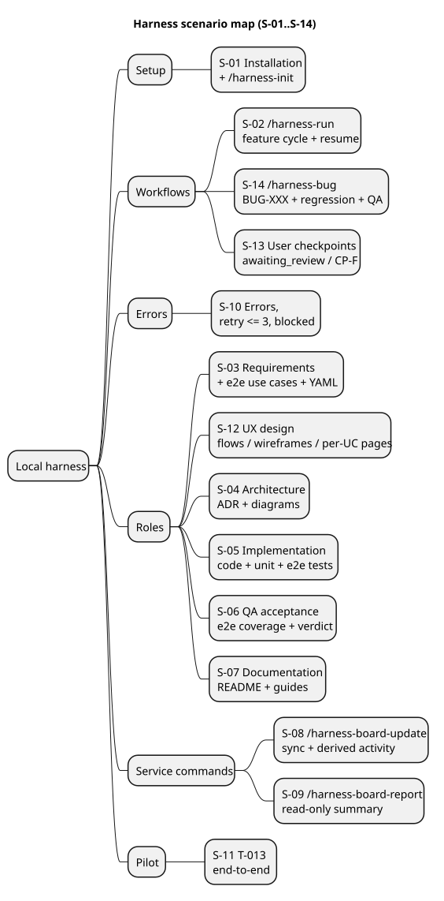

Source: [`diagrams/scenario-map.puml`](diagrams/scenario-map.puml).

| ID | Scenario | Trigger | Roles | Result |
|---|---|---|---|---|
| S-01 | Installation and bootstrap | `install.ps1`, then `/harness-init` | opencode, global harness, Ollama | global agents installed, project initialized |
| S-02 | Task cycle with checkpoints | `/harness-run T-XXX` | harness lead + orchestrator + role | checkpoint review, task `done`/`failed`, commit |
| S-14 | Bugfix workflow | `/harness-bug` then `/harness-run T-XXX` | orchestrator, coder, qa | `BUG-XXX` card, failing regression, fix, independent verification |
| S-03 | Requirements and e2e use cases | analyst task | analyst, local-rag | requirements, `UC-E2E`, YAML data, glossary |
| S-04 | Architecture and diagrams | architect task | architect, MCP PlantUML | ADR, `.puml`/`.svg`, contracts, decomposition |
| S-05 | Implementation, unit + e2e tests | coder task | coder, test runner, e2e runner, Docker | code, tests, CI/CD, local run, e2e evidence |
| S-06 | QA acceptance + e2e coverage | qa task | qa, qa-vision, test/e2e runner, vision | e2e plan/report, review and verdict |
| S-07 | Documentation | doc-writer task | doc-writer | README, runbook, guides, ADR finalization |
| S-08 | Board sync | `harness-board-update all / T-XXX` | orchestrator, MCP, Git | statuses, commits, derived SVG, chore commit |
| S-09 | Board report | `harness-board-report` | orchestrator | summary and recommendations (read-only) |
| S-10 | Errors and blockers | acceptance failure | orchestrator, role, user | `failed` -> retry <=3 -> `blocked`/`done` |
| S-11 | Pilot end-to-end | task T-013 | orchestrator, analyst, architect, qa | confirmed full cycle on "Mini-CRUD" |
| S-12 | UX design | ux-designer task | ux-designer, coder (optional), MCP PlantUML, qa-vision | flows, screens, wireframes, UI spec, per-scenario HTML mockups |
| S-13 | User checkpoints | role checkpoint | user, lead, orchestrator, role | `awaiting_review`, decisions, edits, resume |

---

## 4. Scenarios

### S-01. Harness installation and bootstrap

**Goal:** install harness globally once and initialize it in the project.
**Preconditions:** the harness source repository is available, Ollama is running,
models are loaded.

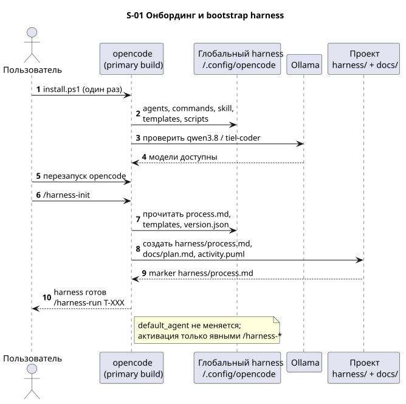

Source: [`diagrams/seq-01-bootstrap.puml`](diagrams/seq-01-bootstrap.puml).

**Result:** agents, commands, skills, workflows, templates, and scripts are in
`~/.config/opencode/`; the project has `harness/process.md`,
`harness/workflows/`, `harness/version.json`, `docs/plan.md`, `docs/bugs/`,
`docs/ux/`, and `docs/checkpoints/`.
**Note:** `default_agent` is not changed; an opencode restart is required after
installing agents. Activation is only via explicit `/harness-*`.

### S-02. Task cycle with checkpoints (`/harness-run`)

**Goal:** take a task from dependency checks through user checkpoints, acceptance,
and commit. **Preconditions:** the project is initialized (`harness/process.md`),
the card `docs/tasks/T-XXX-*.md` exists with a valid `workflow`/`stage`, its
workflow file is present, all `depends_on` are `done`, and no other task is
active (`in_progress` or `awaiting_review`). Tasks run strictly sequentially
across both workflows - parallel starts and feature/bugfix preemption are
forbidden.

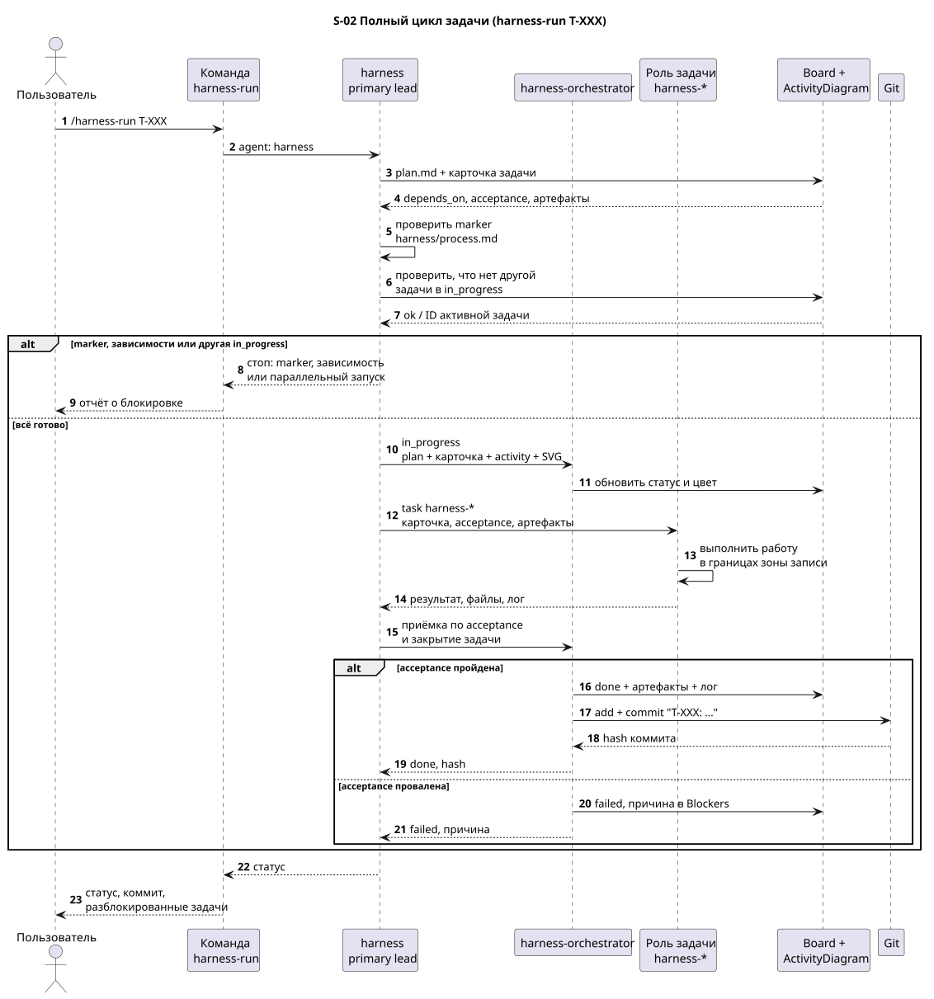

Source: [`diagrams/seq-02-harness-run.puml`](diagrams/seq-02-harness-run.puml).

**Result:** at each checkpoint the task is `awaiting_review` with a checkpoint
file and snapshot commit; after the user's explicit `approved` decision and
`CP-F`, the task is `done`, the plan/card are updated, activity/SVG are
re-rendered as derived artifacts, and a commit `T-XXX: ...` is made; dependent
tasks are unblocked. Statuses are read only from the plan, card, checkpoints,
bug cards, workflows, and Git evidence.
**Errors:** no marker - stop and suggest `/harness-init`; unmet dependencies -
stop without starting; another active task - stop without changing statuses; no
checkpoint decision - stop and ask, never infer approval; `acceptance` failure -
`failed` and cause in `Blockers`.

### S-03. Requirements and e2e use cases (analyst)

**Goal:** collect and refine requirements, check existing materials via RAG, and
formalize end-to-end use cases with test data. **Preconditions:** a statement
exists and `local-rag` is available (when Ollama is unavailable, RAG works in
FTS5 mode).

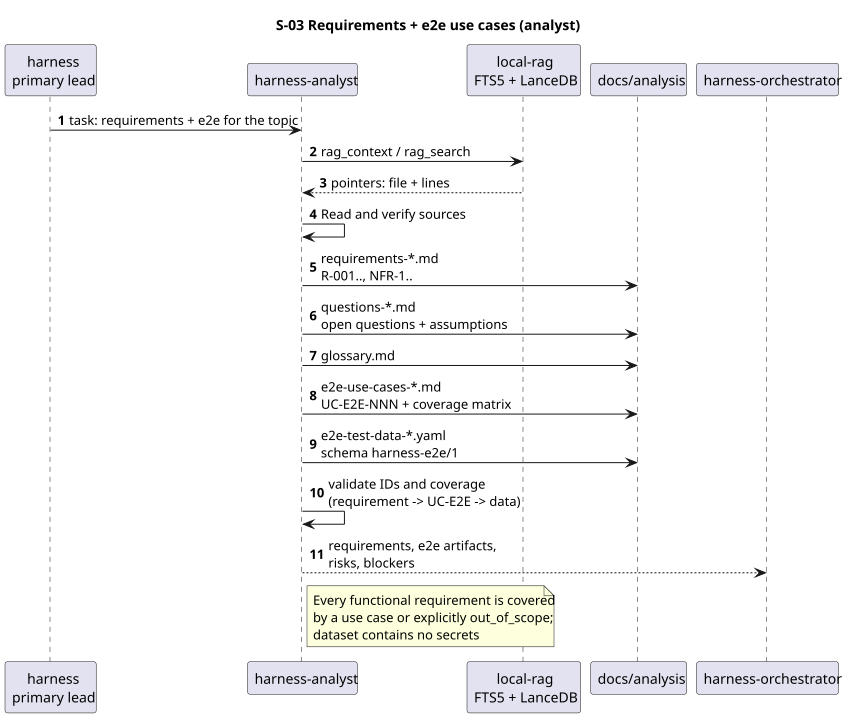

Source: [`diagrams/seq-03-analyst.puml`](diagrams/seq-03-analyst.puml).

**Result:** `docs/analysis/requirements-*.md` with atomic verifiable
requirements `R-NNN`, `questions-*.md` with open questions and assumptions,
`glossary.md`, `e2e-use-cases-*.md` with `UC-E2E-NNN` and a coverage matrix, and
`e2e-test-data-*.yaml` (schema `harness-e2e/1`); an orchestrator report with
risks and blockers. **Rules:** every functional requirement is covered by a use
case or explicitly `out_of_scope`; the dataset contains no secrets and every use
case has expected results and cleanup. **Errors:** missing data is recorded as a
question, not as an invented requirement or use case.

### S-04. Architecture and diagrams (architect)

**Goal:** make an architectural decision with alternatives, produce diagrams and
contracts. **Preconditions:** analyst requirements and e2e use cases are
accepted; UX screen IDs/UI spec are available when the task has a UI.

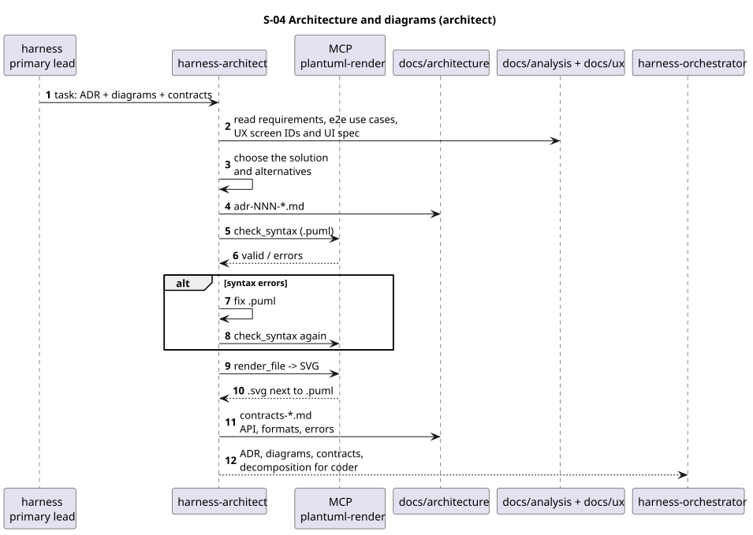

Source: [`diagrams/seq-04-architect.puml`](diagrams/seq-04-architect.puml).

**Result:** an ADR from the template, the overall architecture description
`docs/architecture/architecture-<slug>.md` with `SCN`/`SVC`/`API` IDs,
component and per-scenario sequence diagrams, data and class models, per-service
swimlane diagrams, OpenAPI 3.x specifications, interface contracts, and
decomposition for the coder. All diagrams and specs are linked from the
architecture description. **Mandatory control:** every diagram passes
`check_syntax`, then `render_file`; the registry checks scenario/service/API
coverage, OpenAPI validity, and artifact links; syntax errors are fixed before
handoff. A decision without alternatives is not acceptable.

### S-05. Implementation, unit and e2e tests (coder)

**Goal:** implement strictly per ADRs, contracts, and UX specs, including
deterministic e2e automation. **Preconditions:** ADRs, contracts, UX specs, and
the analyst e2e dataset are accepted; the task includes a local run target.

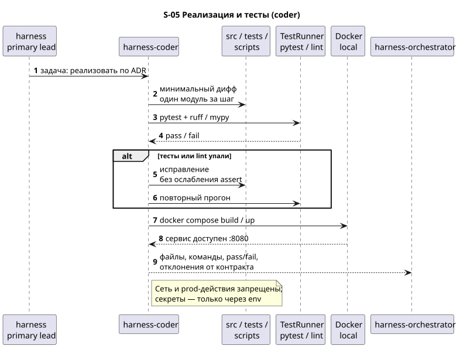

Source: [`diagrams/seq-05-coder.puml`](diagrams/seq-05-coder.puml).

**Result:** code in `src/`, unit/integration tests, `tests/e2e/`, a dataset
validator (`harness/scripts/validate-e2e-data.py` baseline), an isolated e2e runner
(`scripts/e2e.ps1` or `make e2e`) with seed/cleanup and per-`UC-E2E` results,
CI/CD preparation (`Dockerfile`, compose, Makefile), green tests, and a locally
running service. **Errors:** failing tests are fixed without weakening
assertions; e2e uses only local/staging resources; when context is insufficient -
stop with a blocker, not a partial implementation.

### S-06. QA acceptance and e2e coverage (qa + qa-vision)

**Goal:** independently verify artifacts against `acceptance`, including e2e
coverage and execution. **Preconditions:** the role results were passed by the
orchestrator; the coder provided an e2e runner and dataset validator.

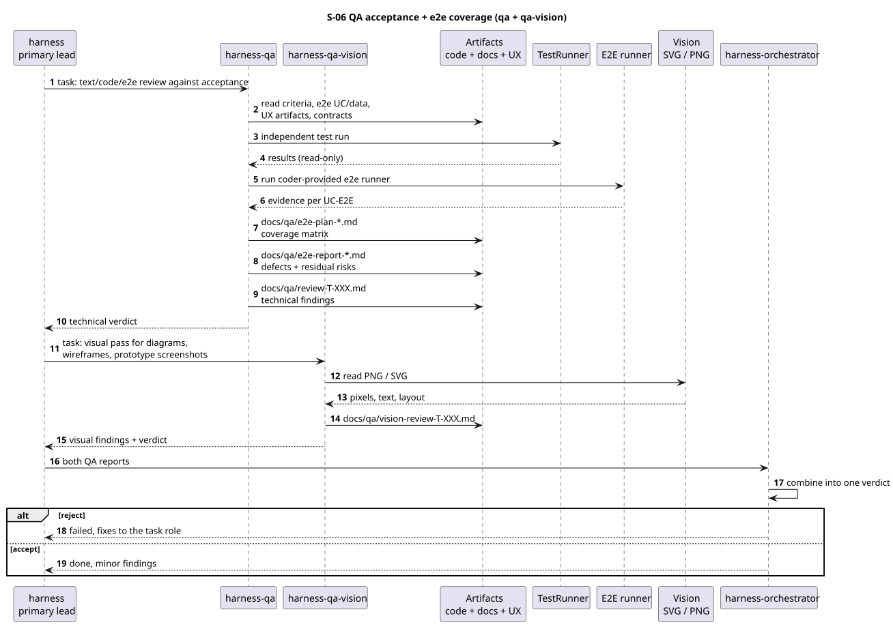

Source: [`diagrams/seq-06-qa.puml`](diagrams/seq-06-qa.puml).

**Result:** `docs/qa/e2e-plan-*.md` with a requirement -> `UC-E2E-NNN` -> test
matrix, `docs/qa/e2e-report-*.md` with run evidence, defects, and residual
risks, and `docs/qa/review-T-XXX.md` with a "criterion -> pass/fail" table,
findings by severity, and an `accept`/`reject` verdict; an independent
unit/integration/e2e run (read-only). For visuals, the lead then runs a separate
`qa-vision` pass and the orchestrator combines both reports into one verdict.
**Errors:** `reject` returns the task for fixes; QA does not edit code, tests, or
artifacts itself; e2e never touches production.

### S-07. Documentation (doc-writer)

**Goal:** bring documentation in line with the actual solution. **Preconditions:**
ADRs, contracts, and implementation are available.

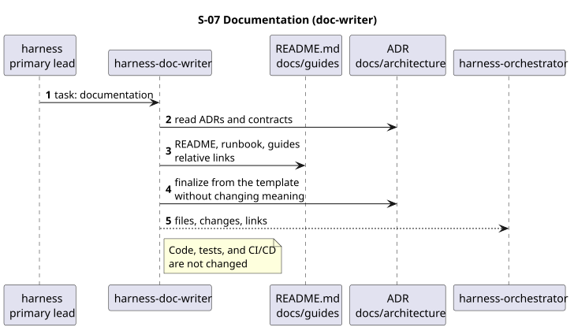

Source: [`diagrams/seq-07-doc-writer.puml`](diagrams/seq-07-doc-writer.puml).

**Result:** README, runbook, guides, ADR finalization from the template; relative
links, verified commands. **Constraint:** do not change the meaning of ADRs and
contracts - only form and completeness.

### S-08. Board sync (`harness-board-update`)

**Goal:** bring the plan and cards in line with the actual state, then re-render
the derived activity diagram. **Preconditions:** the project is initialized;
tasks are completed or statuses changed.

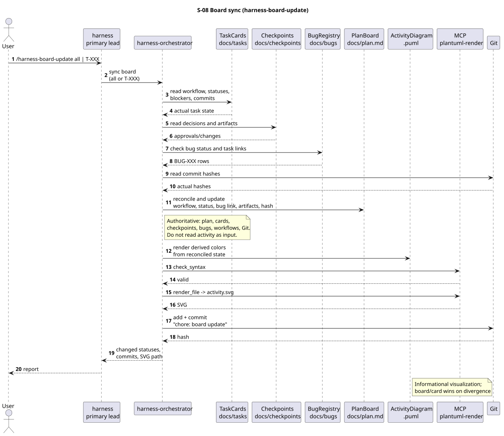

Source: [`diagrams/seq-08-harness-board-update.puml`](diagrams/seq-08-harness-board-update.puml).

**Result:** the `harness` lead delegates to `harness-orchestrator`: update
`docs/plan.md`, cards, the bug index/links, record commit hashes, then update
`docs/activity.puml` colors and re-render `docs/activity.svg` as derived
artifacts; commit `chore: board update (...)`. **Rule:** on divergence, the plan
and task card are the source of truth; activity is never a reconciliation input;
board update is forbidden while a task is active.

### S-09. Board report (`harness-board-report`)

**Goal:** get a summary without changing artifacts. **Preconditions:** the project
is initialized.

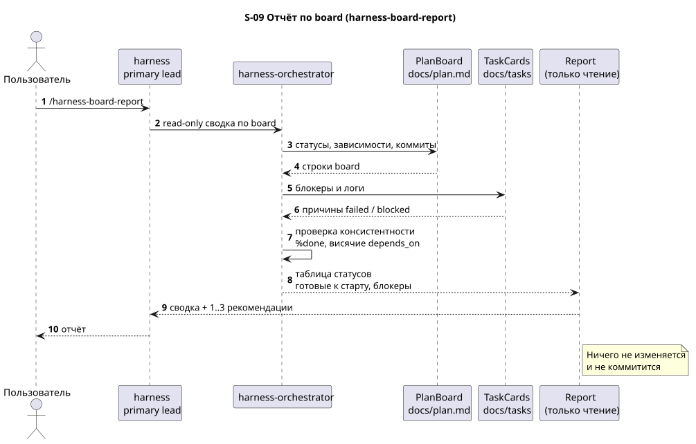

Source: [`diagrams/seq-09-harness-board-report.puml`](diagrams/seq-09-harness-board-report.puml).

**Result:** the `harness` lead delegates to `harness-orchestrator` for a read-only
summary: tasks by workflow, bug queue and severity, tasks ready to start,
`failed`/`blocked` with causes, %done, dangling dependency and bug/task mismatch
checks, 1-3 recommendations. **Rule:** the scenario is strictly read-only;
nothing is committed.

### S-10. Errors, retries, and blockers

**Goal:** handle acceptance failure predictably without losing history.
**Preconditions:** the role returned a result; the orchestrator performed acceptance.

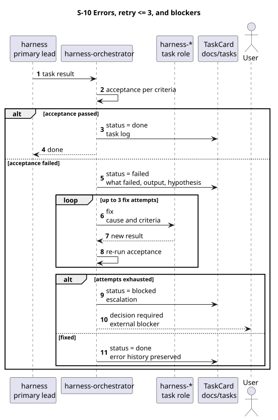

Source: [`diagrams/seq-10-errors.puml`](diagrams/seq-10-errors.puml).

**Result:** on failure the task becomes `failed`, the cause and output are written
to the card; up to 3 fix attempts are made; after exhaustion - `blocked` and
escalation to the user. Error history is not deleted during fixes.

### S-11. Pilot end-to-end cycle T-013

**Goal:** prove the full cycle works on a separate task. **Preconditions:**
harness is assembled (T-001..T-012), roles are available.

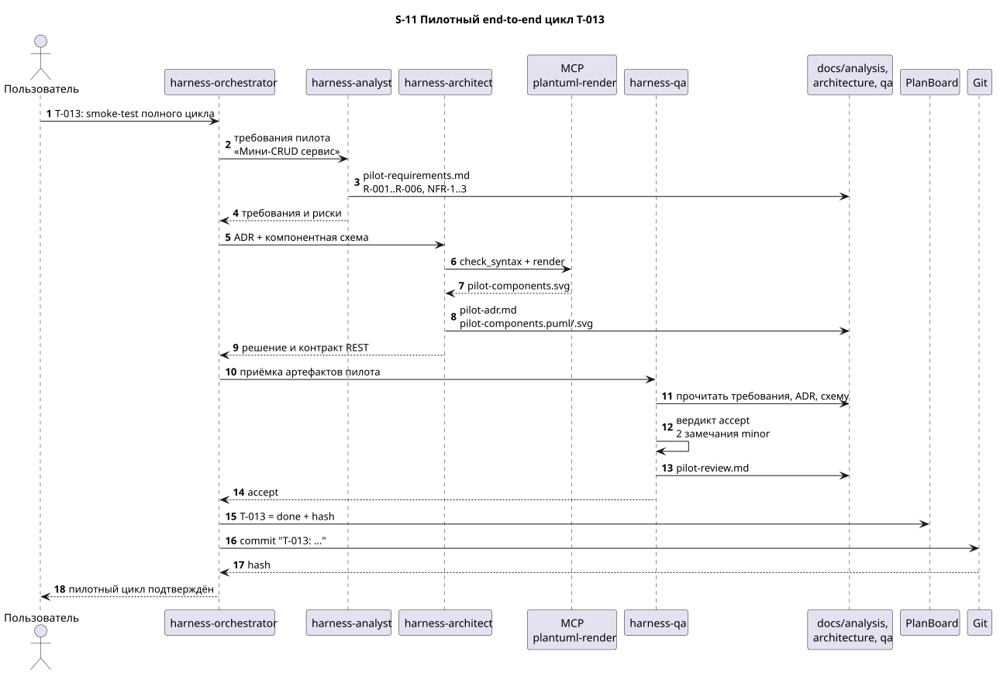

Source: [`diagrams/seq-11-pilot-e2e.puml`](diagrams/seq-11-pilot-e2e.puml).

**Result:** the analyst produced pilot requirements, the architect - an ADR and
component diagram, QA - a review with verdict `accept`; T-013 is `done`, a commit
is made. The pilot confirmed that role prompts are sufficiently deterministic.

### S-12. UX design (ux-designer)

**Goal:** turn accepted requirements and e2e use cases into reviewable UX
artifacts. **Preconditions:** requirements and `UC-E2E` are accepted; the card
marks `ux: required`.

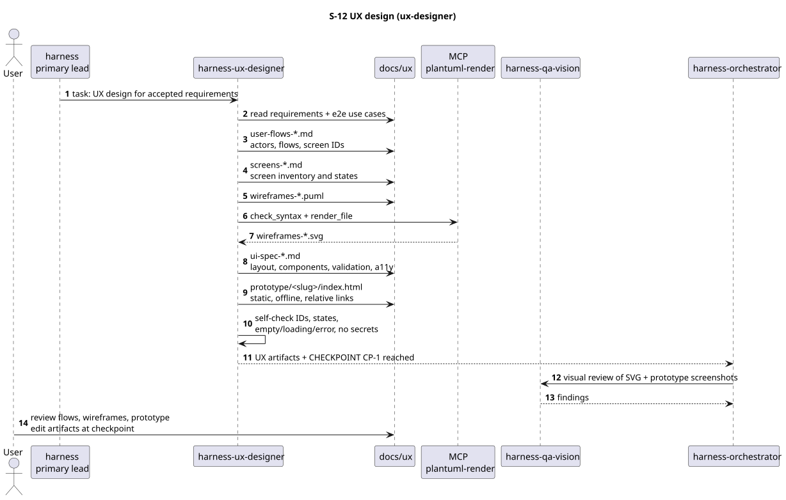

Source: [`diagrams/seq-12-ux-designer.puml`](diagrams/seq-12-ux-designer.puml).

**Result:** `docs/ux/user-flows-*.md`, `screens-*.md`, `wireframes-*.puml` +
`.svg`, `ui-spec-*.md`, and a static HTML prototype with `index.html` plus one
`uc-e2e-NNN.html` page per in-scope use case (or an explicit waiver). Screen IDs
are stable and referenced by architecture contracts and e2e use cases. The UX
designer may delegate page implementation to `harness-coder` one page at a time;
the coder writes only `docs/ux/prototype/<slug>/**` and UX validates. The role
stops at its checkpoint; QA vision and the user review the visuals. **Errors:**
missing requirements - stop and ask the analyst; no production code, external
CDNs, network APIs, or real user data.

### S-13. User checkpoints

**Goal:** give the user a reliable review/edit/approve point without losing task
context. **Preconditions:** the role reached a declared checkpoint.

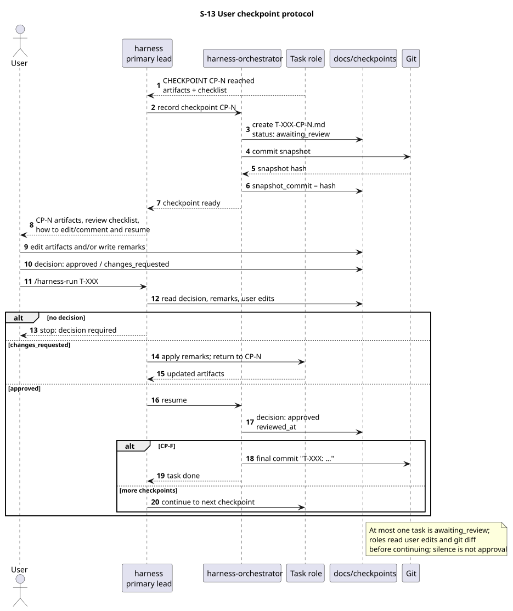

Source: [`diagrams/seq-13-checkpoints.puml`](diagrams/seq-13-checkpoints.puml).

**Result:** the task is `awaiting_review`; `docs/checkpoints/T-XXX-CP-N.md`
records artifacts, snapshot commit, user remarks/edits, and the decision. On
`approved` the role continues; on `changes_requested` it returns to the same
checkpoint. `CP-F` is mandatory before `done`. **Errors:** missing decision -
stop and ask; user edits - authoritative, preserve them; at most one task may be
`awaiting_review`.

### S-14. Bugfix workflow (`/harness-bug` -> `/harness-run`)

**Goal:** restore expected behavior through a durable `BUG-XXX` report, a
reproduction, a failing regression test, a minimal fix, and independent QA.
**Preconditions:** the expected behavior exists; a report has observed/expected
behavior, reproduction, and environment; no other active task.

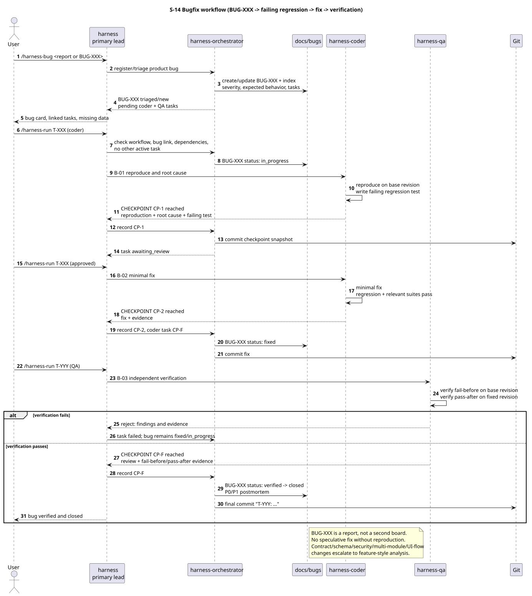

Source: [`diagrams/seq-14-bugfix.puml`](diagrams/seq-14-bugfix.puml).

**Result:** `docs/bugs/BUG-XXX-*.md` and the index are updated; the coder stops at
`CP-1` with reproduction/root cause and a regression test that fails on the base
revision, then at `CP-2` with the minimal fix and green regression. QA verifies
fail-before/pass-after independently and records `docs/qa/review-T-XXX.md`. The
bug moves `fixed` -> `verified` -> `closed` only after `CP-F`; P0/P1 require a
postmortem. **Errors:** missing reproduction data - keep the bug `new` and ask;
no speculative fix. Contract/schema/security/multi-module/UI-flow changes
escalate to feature-style analysis and design.

---

## 5. Conceptual class model

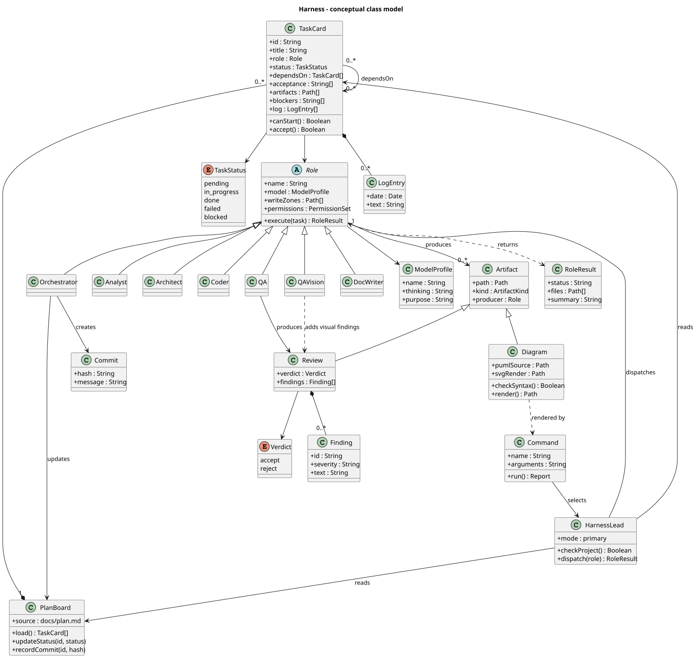

Source: [`diagrams/class-harness.puml`](diagrams/class-harness.puml).

The model is conceptual: it describes the harness domain (board, tasks, roles,
artifacts), not the classes of a specific application.

| Class | Purpose |
|---|---|
| `PlanBoard` | board `docs/plan.md`: workflow, tasks, statuses, bug links, commits |
| `Workflow` | `feature` or `bugfix`: stage table, task graph, applicability, gates |
| `TaskCard` | task card: id, workflow, stage, role, dependencies, acceptance, inputs, e2e/ux or bug/severity, checkpoints, artifacts, blockers, log |
| `TaskStatus` | statuses `pending`, `in_progress`, `awaiting_review`, `done`, `failed`, `blocked` |
| `BugReport` | `BUG-XXX`: observed/expected behavior, reproduction, severity, tasks, root cause, fix, verification |
| `BugStatus` | `new`, `triaged`, `in_progress`, `fixed`, `verified`, `closed`, `duplicate`, `wontfix` |
| `Checkpoint` | review point: ID, stage, artifacts, snapshot commit, remarks, decision |
| `CheckpointDecision` | `awaiting_review`, `approved`, `changes_requested` |
| `Role` | abstract role: model, permissions, write areas, task execution |
| `Orchestrator`, `Analyst`, `UxDesigner`, `Architect`, `Coder`, `QA`, `QAVision`, `DocWriter` | concrete harness roles |
| `ModelProfile` | local model, thinking mode, purpose |
| `E2EUseCase` | `UC-E2E-NNN`: actor, priority, steps, cleanup, traceability |
| `TestDataset` | YAML `harness-e2e/1`: environment and use-case data |
| `Artifact` | role artifact with path, type, and producer |
| `Diagram` | PlantUML source and SVG render; validation and rendering |
| `Review` | QA report: verdict and findings list |
| `Finding` | finding with ID, severity, and text |
| `Commit` | task git commit: hash and message |
| `Command` | opencode command: `/harness-feature`, `/harness-bug`, `/harness-run`, `/harness-board-*` |
| `HarnessLead` | primary agent `harness`: marker, workflow routing, checkpoints, report; writes no files |
| `LogEntry` | task card log entry |
| `RoleResult` | role result: status, files, summary |

Key relationships: `PlanBoard 1 *-- 0..* TaskCard`; every card selects one
`Workflow` and has one `TaskStatus`; `TaskCard` depends on other cards
(`dependsOn`), is assigned to one role, and owns 1..* checkpoints; a bugfix card
links to one `BugReport`; a bug report owns many tasks and one `BugStatus`; a
role produces many artifacts; `Diagram` and `Review` inherit `Artifact`;
`Analyst` formalizes `E2EUseCase` and produces `TestDataset`; `HarnessLead` is
selected by a command, reads the board/cards/bugs/checkpoints, and calls roles;
the orchestrator updates the board, bug registry, checkpoint decisions, and
creates commits.

---

## 6. Process, statuses, and control

### 6.1 Task lifecycle

1. The `harness` lead reads the card's `workflow`/`stage`, loads the matching
   workflow file, checks the project marker, `depends_on` (all `done`), and that
   no other task is active (`in_progress` or `awaiting_review`).
2. `harness-orchestrator` sets the task to `in_progress` in the plan and card,
   then re-renders the derived activity color, and updates the linked bug to
   `in_progress` for the first bugfix task.
3. The role performs the current stage strictly per the card's `acceptance` and
   stops at the next checkpoint; bugfix cannot pass reproduction without a
   failing regression test.
4. The orchestrator creates `docs/checkpoints/T-XXX-CP-N.md`, sets
   `awaiting_review`, updates the bug status when applicable, and commits a
   snapshot.
5. The user reviews/edits artifacts and records `approved` or
   `changes_requested`; `/harness-run` resumes the role.
6. After the final role checkpoint and `CP-F` approval,
   `harness-orchestrator` accepts the result; on failure - `failed`.
7. Status -> `done`, bug status (`fixed`/`verified`/`closed`), log entry,
   plan/card update, derived activity/SVG re-render, and commit.

Tasks run strictly sequentially across both workflows: at most one task is
`in_progress` or `awaiting_review` at a time; feature/bugfix preemption and
parallel task starts are forbidden. New pending cards and bug reports may be
registered while a task is active.

Status, dependencies, active task, acceptance, checkpoint decisions, and routing
are determined from the plan, task cards, checkpoints, bug cards, workflows, and
Git evidence. `docs/activity.puml`, `docs/activity.svg`, and derivatives are
informational visualizations; on divergence the plan/card wins and the activity
is re-rendered.

### 6.2 Statuses

| Status | Color | Meaning |
|---|---|---|
| `pending` | `#D3D3D3` | not started |
| `in_progress` | `#FFE082` | in progress |
| `awaiting_review` | `#87CEFA` | waiting for user checkpoint review |
| `done` | `#90EE90` | completed, accepted, `CP-F` approved |
| `failed` | `#FF9090` | error, fix required |
| `blocked` | `#FFB347` | external blocker |

Allowed transitions: `pending -> in_progress`; `in_progress -> awaiting_review`
at a checkpoint; `awaiting_review -> in_progress` after approval or a change
request, except `CP-F` approval which goes to `done`; `awaiting_review -> done`
only after `CP-F` approval;
`in_progress -> failed`; `failed -> in_progress` (after a fix); `* -> blocked` on
an external blocker.

### 6.3 Mandatory artifact update order

1. `docs/plan.md` - workflow, status, artifacts, bug link, commit hash.
2. `docs/tasks/T-XXX-*.md` - status, log, blockers, checkpoint list.
3. `docs/bugs/BUG-XXX-*.md` and `docs/bugs/README.md` - bug status, tasks, root
   cause, fix, verification (orchestrator only).
4. `docs/checkpoints/T-XXX-CP-N.md` - artifacts, decision, user remarks/edits,
   snapshot commit.
5. `docs/activity.puml` - task block color, derived from steps 1-4 only.
6. Re-render `docs/activity.svg` via MCP `plantuml-render`.
7. `git commit` with checkpoint snapshot message or final `T-XXX: ...`.

Activity is re-rendered after the authoritative state is final; it is never read
to determine or reconcile that state.

### 6.4 Git discipline

- Repository at the project root; default branch `master`.
- At least one commit per task; format `T-XXX: short description`.
- Forbidden: `git push`, `git tag`, history rewrite, committing secrets and `.env`.
- Only task files are included in the commit.

### 6.5 Plan execution diagram

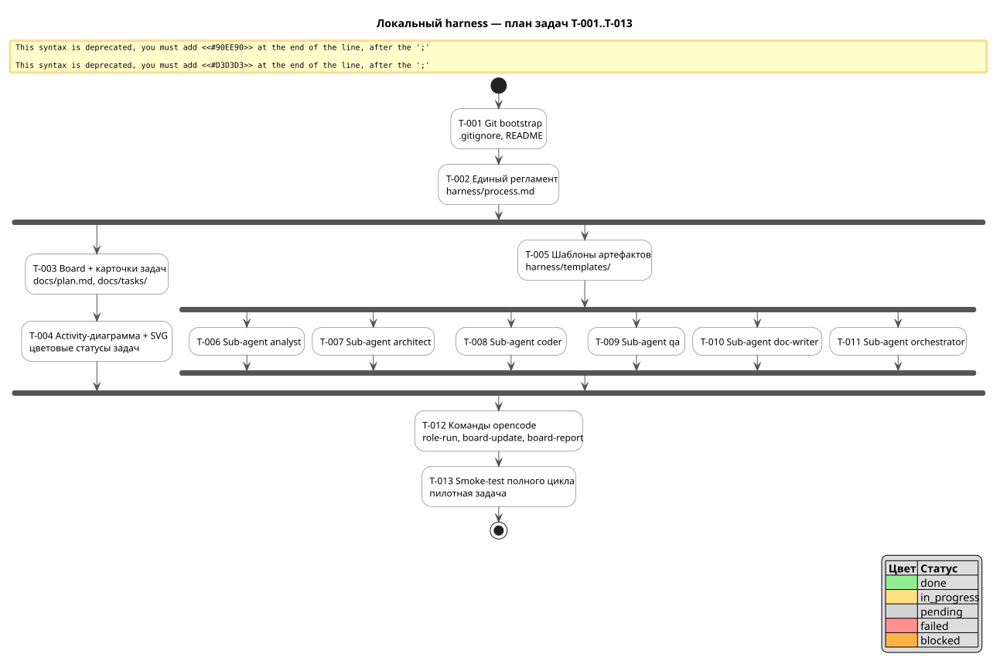

Source: [`docs/activity.puml`](../activity.puml). Green - `done`, gray -
`pending`, yellow - `in_progress`, blue - `awaiting_review`, red - `failed`,
orange - `blocked`. This is a derived visualization; the board and cards are
authoritative for all status and acceptance decisions.

### 6.6 Bug and issue logs

Product defects use the `BUG-XXX` registry:

- `docs/bugs/BUG-XXX-<slug>.md` - one bug report, root cause, fix, verification;
- [`docs/bugs/README.md`](../bugs/README.md) - bug index.

Harness problems are recorded by the `harness-issues` skill:

- `docs/issues/ISSUE-YYYYMMDD-HHMMSS-<slug>.md` - one problem;
- [`docs/issues/README.md`](../issues/README.md) - index list.

A harness issue record contains status, severity, type, source, role, absolute
location, symptoms, reproduction, cause, solution/workaround, verification,
prevention, and timeline. All roles may create issue files; the
`harness-orchestrator` verifies the index and includes them in the task commit.
Only `docs/issues/` is valid; a root `harness-issues/` directory is not a
registry. `/harness-doctor` checks the index in both directions. Only the
orchestrator edits bug cards. Secrets are never written to either log.

---

## 7. Pilot case "Mini-CRUD service" (T-013)

The pilot checks the analyst -> architect -> qa cycle on a separate task: REST CRUD
for notes, SQLite, local Docker, deterministic tests. One user, no auth, no
external integrations.

### 7.1 Requirements

| ID | Requirement |
|---|---|
| R-001 | `POST /notes` with `title`, `body`; response 201 with `id`. |
| R-002 | `GET /notes` - array of notes, sorted by `created_at` descending. |
| R-003 | `GET /notes/{id}`; 404 if missing. |
| R-004 | `PUT /notes/{id}` with `title`, `body`; 404 if missing. |
| R-005 | `DELETE /notes/{id}`; 204 on success, 404 if missing. |
| R-006 | Validation: `title` 1..200 characters, `body` up to 10000; error 422. |
| NFR-1 | `docker compose up` starts the service on port 8080. |
| NFR-2 | SQLite file in a volume; survives container restart. |
| NFR-3 | Unit + API tests, deterministic, no network. |

Pilot open questions: pagination is not needed (Q-001), full-text search is out
of scope (Q-002). Risks: SQLite file growth (R1), no auth - local/staging only
(R2). Full requirements: [`docs/analysis/pilot-requirements.md`](../analysis/pilot-requirements.md).

### 7.2 Architectural decision (ADR-001)

Stack: Python 3.12 + FastAPI + SQLAlchemy 2.x (SQLite) + Pydantic v2. Structure:
thin API layer -> service layer -> repository. Tests: pytest + httpx (ASGI
transport). Container: `python:3.12-slim`, docker compose with a DB volume.

| Alternative | Why rejected |
|---|---|
| Flask + SQLite | manual validation, less typing |
| Node/Express + better-sqlite3 | second stack in the local environment |
| Django + DRF | overkill for one CRUD |

Full ADR: [`docs/architecture/pilot-adr.md`](../architecture/pilot-adr.md).

### 7.3 REST contract

| Method | Path | Body | Response |
|---|---|---|---|
| POST | `/notes` | `{title, body}` | 201 `{id, title, body, created_at}` |
| GET | `/notes` | - | 200 `[...]` |
| GET | `/notes/{id}` | - | 200 / 404 |
| PUT | `/notes/{id}` | `{title, body}` | 200 / 404 |
| DELETE | `/notes/{id}` | - | 204 / 404 |

Errors: `{"detail": "..."}`; validation - 422 (Pydantic).

### 7.4 Pilot component diagram

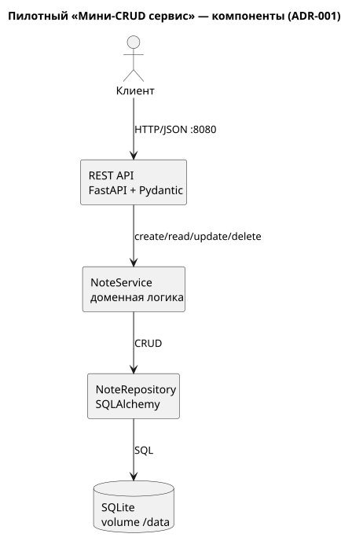

Source: [`docs/architecture/pilot-components.puml`](../architecture/pilot-components.puml).

### 7.5 Pilot class model

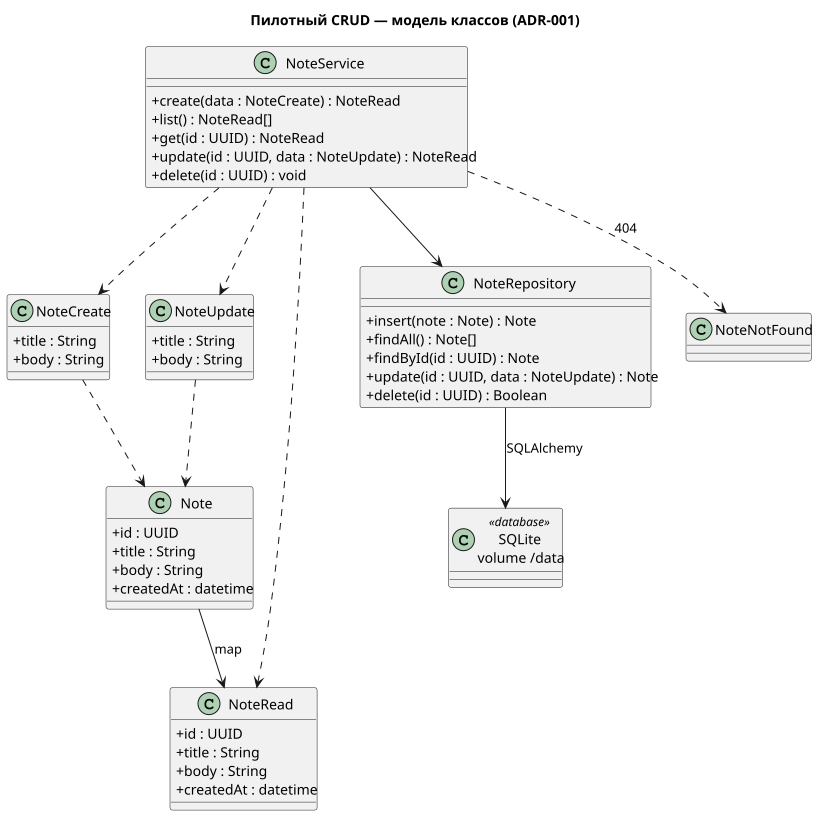

Source: [`diagrams/class-pilot.puml`](diagrams/class-pilot.puml).

`Note` - domain entity; `NoteCreate`/`NoteUpdate` - input schemas; `NoteRead` -
output schema; `NoteService` - domain logic; `NoteRepository` - SQLite access;
`NoteNotFound` - 404 error.

### 7.6 QA result

Verdict: **accept**. Minor findings: N-001 - the Python image version is not
pinned (pin in Dockerfile at the coder stage); N-002 - the `created_at` format is
not described (ISO-8601 UTC). Full report:
[`docs/qa/pilot-review.md`](../qa/pilot-review.md).

---

## 8. Operations

### 8.1 Global installation and quick start

1. From the repository root, run the global installation:
   `powershell -NoProfile -ExecutionPolicy Bypass -File harness/scripts/install.ps1`.
2. Restart opencode; check the installation with `/harness-doctor`.
3. In the project, run `/harness-init`; check `harness/process.md`,
   `harness/workflows/`, and `docs/plan.md`.
4. Start a feature with `/harness-feature <slug> [e2e] [ux]` or a bug with
   `/harness-bug <report>`; review the created pending cards.
5. Start a task with `/harness-run T-XXX`; stop at the checkpoint, review/edit
   artifacts, record a decision, and resume.
6. Summary: `/harness-board-report`; sync: `/harness-board-update all`.
7. Diagram: `docs/activity.puml`, render: `docs/activity.svg`.

`default_agent` is not switched to harness: activation is only via explicit
`/harness-*`. Global installation is per current user (`~/.config/opencode`).

### 8.2 Commands

| Command | Argument | Purpose |
|---|---|---|
| `/harness-init` | - | create harness, workflows, bug registry, and marker files in the current project |
| `/harness-feature` | `<slug> [e2e] [ux]` | create a pending `P-00` feature planning task |
| `/harness-bug` | `<report or BUG-XXX>` | create/triage a `BUG-XXX` card and pending bugfix tasks |
| `/harness-run` | `T-XXX` | workflow/dependency checks, `in_progress`, role call, checkpoint, resume, acceptance, commit |
| `/harness-board-update` | `T-XXX` or `all` | reconcile plan/cards/bugs/checkpoints/commits, then re-render the derived activity diagram and SVG when no task is active |
| `/harness-board-report` | - | read-only summary: tasks by workflow, bug queue, pending reviews, blockers, recommendations |
| `/harness-doctor` | - | check the global installation and the current project |

### 8.3 How to add work

1. Use `/harness-feature <slug> [e2e] [ux]` for new behavior or
   `/harness-bug <report>` for a defect.
2. The orchestrator creates a card from `harness/templates/task-card-feature.md`
   or `task-card-bugfix.md` (bugfix also gets a `docs/bugs/BUG-XXX-*.md` card).
3. Add/verify the row in `docs/plan.md` from `harness/templates/plan-row.md`.
4. Specify `workflow`, `stage`, role, `depends_on`, `acceptance`, `inputs`,
   e2e/UX or bug/severity applicability, and checkpoints (at least `CP-F`).
5. Run `/harness-run T-XXX` after dependencies are done; never start a second
   active task.
6. Review each checkpoint, record a decision, and resume; after `CP-F`, update
   the plan/card/bug/checkpoint state, re-render the derived activity as the last
   step, and commit.

### 8.4 Limitations and risks

- SQLite is not designed for concurrent writes - accepted for the pilot.
- No auth - the service is local/staging only.
- Models are local: quality and speed depend on hardware; when Ollama is
  unavailable, RAG works in FTS5 mode.
- Diagrams and documentation require periodic reconciliation with code.
- Role prompts are deterministic but do not guarantee a perfect first pass -
  `failed` and retry <= 3 are provided.
- E2E tests target local/staging only; production data and deployment are
  forbidden.
- Feature and bugfix work never run in parallel; a hotfix waits behind the active
  task instead of preempting it.
- A bugfix without a reproducible failure stays `blocked` at `CP-1`; no
  speculative fix is allowed.
- Checkpoints require explicit user decisions; stale checkpoint files are caught
  during board reconciliation, not automatically.

### 8.5 HTML build

The HTML version is generated from this file and requires no network:

```powershell
python docs/description/build_html.py
```

The script embeds all SVGs as `data:` URIs, wraps diagrams in zoomable figures,
and builds `docs/description/index.html`. The page template and modal styles/JS
are in `docs/description/template.html`. Python 3.12 and the `markdown` package
are required.

### 8.6 Troubleshooting

| Symptom | Cause | Action |
|---|---|---|
| role is not visible in opencode | agents were added after startup | restart opencode |
| model is unavailable | Ollama is not running / model is not loaded | start Ollama, `ollama pull` |
| RAG answers without embeddings | Ollama is unavailable | FTS5 mode; does not block the task |
| diagram does not render | PlantUML error | `check_syntax`, fix `.puml`, rerun `render_file` |
| task does not start | a dependency is not `done` | check `depends_on` and card statuses |
| second task was requested | one active task exists across both workflows | finish or review the active task; no preemption |
| card has no workflow/stage | legacy or malformed card | add a valid workflow/stage; bugfix also needs `bug`/`severity` |
| bug cannot be reproduced | insufficient report/evidence | keep `BUG-XXX` `new` or `blocked`; request reproduction data |
| product bug was filed in `docs/issues/` | wrong registry | move it to `docs/bugs/`; keep harness issues separate |
| `task` fails with `Subagent depth limit` | `subagent_depth` is missing/1, or compaction handoff created a child continuation | run install to set `subagent_depth: 2`; fix/disable the handoff plugin, start a new root session, resume `/harness-run` |
| QA returns an empty report or `finish=length` | `limit.context` is above the real `num_ctx` or output budget is small | run `/harness-doctor`, compare `ollama show` with `limit.context`, chunk the artifact per `process.md` 11.1, resume in a fresh session |
| analyst/coder self-sub-session is denied | global `permission.task` or the role self allow is missing | run install, restart opencode, check `/harness-doctor` |
| artifact exceeds the budget | oversized single generation | split the chunk, use `harness/scripts/check-budget.ps1`, start a fresh role session |
| `rag_sync` times out or returns `Sync already running` | indexing exceeds the local-rag MCP timeout | verify with `rag_search`, retry after the lock releases; consider a larger timeout |
| issue files are missing from the index | a record was created outside `docs/issues/` | move it to `docs/issues/`, add the row, rerun `/harness-doctor` |

---

## 9. Traceability

| Scenario | Artifacts | Source |
|---|---|---|
| S-01 | global agents, project marker | [`harness/scripts/install.ps1`](../../harness/scripts/install.ps1), [`harness/commands/harness-init.md`](../../harness/commands/harness-init.md) |
| S-02 | plan, card, checkpoints, derived activity, commit | [`harness/commands/harness-run.md`](../../harness/commands/harness-run.md) |
| S-03 | requirements, e2e UC/YAML, questions, glossary | [`harness/agents/harness-analyst.md`](../../harness/agents/harness-analyst.md) |
| S-04 | ADR, diagrams, contracts | [`harness/agents/harness-architect.md`](../../harness/agents/harness-architect.md) |
| S-05 | code, unit/e2e tests, CI/CD | [`harness/agents/harness-coder.md`](../../harness/agents/harness-coder.md) |
| S-06 | e2e plan/report, review, visual findings | [`harness/agents/harness-qa.md`](../../harness/agents/harness-qa.md), [`harness/agents/harness-qa-vision.md`](../../harness/agents/harness-qa-vision.md) |
| S-07 | README, guides, ADR | [`harness/agents/harness-doc-writer.md`](../../harness/agents/harness-doc-writer.md) |
| S-08 | board, cards, derived activity | [`harness/commands/harness-board-update.md`](../../harness/commands/harness-board-update.md) |
| S-09 | board summary | [`harness/commands/harness-board-report.md`](../../harness/commands/harness-board-report.md) |
| S-10 | `failed`/`blocked`, log | [`harness/process.md`](../../harness/process.md), section 11 |
| S-11 | pilot requirements, ADR, QA | [`docs/tasks/T-013-smoke-test.md`](../tasks/T-013-smoke-test.md) |
| S-12 | UX flows, screens, wireframes, prototype | [`harness/agents/harness-ux-designer.md`](../../harness/agents/harness-ux-designer.md) |
| S-13 | checkpoint files, decisions, resume | [`harness/templates/checkpoint.md`](../../harness/templates/checkpoint.md), [`harness/process.md`](../../harness/process.md) |
| S-14 | BUG card, reproduction, regression, verification | [`harness/commands/harness-bug.md`](../../harness/commands/harness-bug.md), [`harness/workflows/bugfix.md`](../../harness/workflows/bugfix.md), [`harness/templates/bug-card.md`](../../harness/templates/bug-card.md) |

---

## 10. File map

| Path | Contents |
|---|---|
| `README.md` | harness overview and quick start |
| `requirements/initial.txt` | initial requirements |
| `harness/process.md` | shared process rules |
| `harness/workflows/*.md` | feature and bugfix stage tables, graphs, gates |
| `harness/agents/*.md` | primary agent `harness` and role subagents |
| `harness/commands/*.md` | `/harness-*` commands |
| `harness/skills/harness/SKILL.md` | global harness skill |
| `harness/skills/harness-issues/SKILL.md` | problem and solution tracking skill |
| `harness/templates/*` | feature/bugfix cards, bug card, ADR, architecture description, OpenAPI, plan-row, issue, checkpoint, e2e, UX templates |
| `harness/scripts/*.ps1` | install, init, doctor, uninstall, new-issue, verification |
| `harness/scripts/validate-*.py` | e2e dataset and OpenAPI 3.x validators |
| `harness/version.json` | installation version |
| `docs/plan.md` | task board with workflow and bug columns |
| `docs/tasks/*.md` | task cards |
| `docs/bugs/` | product bug cards and index |
| `docs/checkpoints/*.md` | user checkpoint decisions and edits |
| `docs/issues/` | harness problem and solution log |
| `docs/analysis/` | pilot requirements, e2e UC/data |
| `docs/ux/` | flows, screens, wireframes, UI spec, prototype catalog and per-scenario HTML pages |
| `docs/architecture/` | architecture description, ADRs, contracts, component/scenario/data/class/swimlane diagrams, OpenAPI specs |
| `docs/qa/` | reviews, e2e plans/reports |
| `docs/activity.puml/.svg` | derived plan activity diagram (informational) |
| `docs/description/` | this description, diagrams, and HTML |
| `docs/description/README.md` | source description (Markdown) |
| `docs/description/diagrams/` | `.puml` sources and `.svg` renders |
| `docs/description/build_html.py` | self-contained HTML build |
| `docs/description/template.html` | HTML template, CSS, and pan/zoom modal |
| `docs/description/index.html` | self-contained HTML version with zoom modal |
| `docs/guides/harness-global.md` | global installation, activation, pin, troubleshooting |

---

## Appendix. Glossary

| Term | Meaning |
|---|---|
| Harness | local system of role subagents with a shared plan and process |
| Sub-agent | a role called by a primary agent via `task` |
| Board | `docs/plan.md` - task table with workflows, statuses, dependencies, bug links |
| Workflow | `feature` (new behavior) or `bugfix` (restore expected behavior) |
| Task card | MD file with id, workflow, stage, role, `depends_on`, `acceptance`, log |
| Bug card | `BUG-XXX` report: observed/expected behavior, reproduction, severity, fix, verification |
| Hotfix | P0/P1 modifier that may defer docs but never reproduction, regression, QA, or postmortem |
| Acceptance | verifiable task acceptance criteria |
| Checkpoint | declared review point with a `docs/checkpoints/` file and user decision |
| `CP-F` | mandatory final checkpoint before a task can be `done` |
| `UC-E2E-NNN` | stable end-to-end use-case identifier used by tests and QA |
| UX artifact | user flows, screens, wireframes, UI spec, prototype catalog, or per-scenario HTML page |
| Artifact | a file or set of files created by a role |
| ADR | Architecture Decision Record |
| MCP | tool protocol; here - `plantuml-render` and `local-rag` |
| RAG | search over a local index (FTS5 + LanceDB + Ollama) |
| SVG | vector diagram format, scales without quality loss |
| Pan/zoom | drag and scale a diagram in an HTML modal |

---

## Sources

- [`requirements/initial.txt`](../../requirements/initial.txt) - initial requirements.
- [`README.md`](../../README.md) - repository layout and quick start.
- [`docs/guides/harness-global.md`](../guides/harness-global.md) - global installation and activation.
- [`harness/process.md`](../../harness/process.md) - shared process rules.
- [`harness/workflows/feature.md`](../../harness/workflows/feature.md) - feature workflow.
- [`harness/workflows/bugfix.md`](../../harness/workflows/bugfix.md) - bugfix workflow.
- [`docs/plan.md`](../plan.md) - task board T-001..T-030.
- [`docs/analysis/pilot-requirements.md`](../analysis/pilot-requirements.md) - pilot requirements.
- [`docs/architecture/pilot-adr.md`](../architecture/pilot-adr.md) - ADR-001.
- [`docs/architecture/adr-002-harness-e2e-ux-checkpoints.md`](../architecture/adr-002-harness-e2e-ux-checkpoints.md) - ADR-002.
- [`docs/architecture/adr-003-feature-bugfix-workflows.md`](../architecture/adr-003-feature-bugfix-workflows.md) - ADR-003.
- [`docs/qa/pilot-review.md`](../qa/pilot-review.md) - pilot QA review.
- [`docs/tasks/T-013-smoke-test.md`](../tasks/T-013-smoke-test.md) - pilot cycle card.
