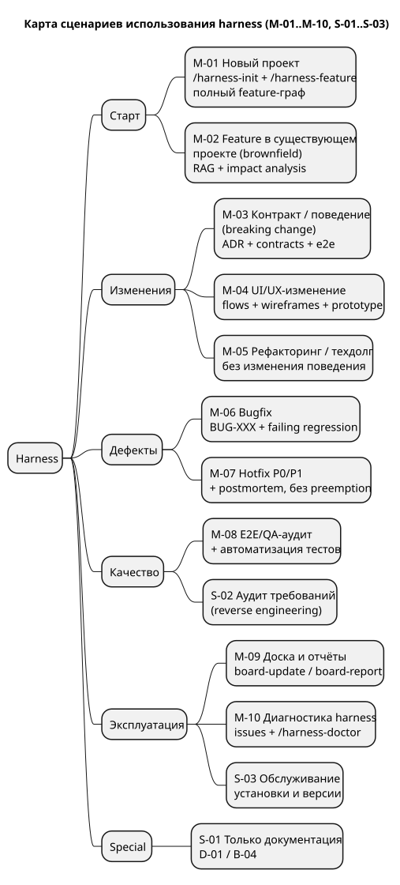
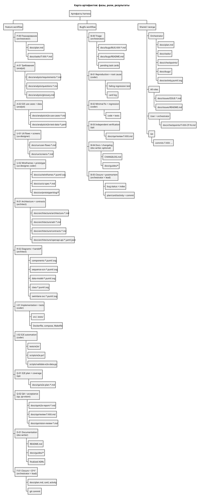
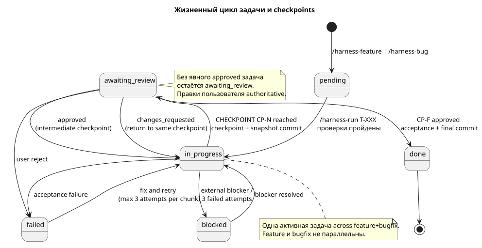

# Harness: руководство по использованию

| Поле | Значение |
|---|---|
| Статус | current |
| Версия harness | 2.6.0 |
| Дата | 2026-11-13 |
| Область | локальный мультиагентный harness: feature + bugfix workflows |
| Нормативные источники | [`harness/process.md`](../../harness/process.md), [`harness/workflows/feature.md`](../../harness/workflows/feature.md), [`harness/workflows/bugfix.md`](../../harness/workflows/bugfix.md) |
| HTML-версия | [`index.html`](index.html) |
| Исходники диаграмм | [`diagrams/`](diagrams/) |

Это практическое руководство: как выбирать сценарий, какие команды запускать, кто и
что делает на каждой фазе, какие артефакты появляются и где проходят checkpoints.
Если руководство расходится с `harness/process.md` или workflow-файлом, побеждают
нормативные источники.

---

## 1. Назначение и область применения

Harness — локальный процесс разработки, в котором работу выполняют ролевые
subagent-ы по общему плану `docs/plan.md`. Каждая задача имеет workflow, стадию,
ответственную роль, зависимости, критерии приёмки и checkpoints. Модели работают
локально через Ollama; внешние API не используются.

Поддерживаются два базовых workflow:

- **feature** — новое поведение, новый проект/подсистема, изменение, требующее
  требований, проектирования или UX-решений;
- **bugfix** — восстановление уже ожидаемого поведения через воспроизведение,
  падающий regression-тест, минимальный фикс и независимую проверку.

Третьего workflow нет. `hotfix` — это модификатор для P0/P1 внутри `bugfix`, а не
отдельный workflow.

### 1.1. Когда использовать harness

- Нужен управляемый цикл: требования → e2e → UX → архитектура → код → QA → docs.
- Работа затрагивает несколько ролей и требует checkpoints пользователя.
- Нужна прослеживаемость: plan, карточки задач, bug-карточки, checkpoints,
  артефакты, коммиты.
- Нужно исправить дефект с доказательством fail-before/pass-after.
- Нужен аудит e2e/QA или формализация требований в рамках feature-плана.

### 1.2. Когда harness не нужен

- Обычная небольшая правка без плана, зависимостей и checkpoints.
- Эксперимент, исследование или разовая задача без артефактов приёмки.
- Нужна только консультация или объяснение кода.
- Работа не должна менять board и процессы проекта.

Harness активируется только явными командами `/harness-*`; `default_agent` не
переключается на harness.

### 1.3. Ключевые инварианты

1. **Одна активная задача.** Одновременно допустима только одна задача в
   состоянии `in_progress` или `awaiting_review` across оба workflow. Feature и
   bugfix не выполняются параллельно и не вытесняют друг друга.
2. **Строгая последовательность.** Новые bug-отчёты и `pending`-карточки можно
   регистрировать при активной задаче, но нельзя менять существующие статусы,
   зависимости и активную задачу.
3. **Checkpoints обязательны.** У каждой задачи есть минимум один checkpoint;
   `CP-F` обязателен до статуса `done`.
4. **Решение пользователя явное.** Молчание не считается одобрением. Правки
   пользователя в артефактах и checkpoint-файле авторитетны.
5. **Источники истины.** Статусы, зависимости, активная задача, приёмка и
   маршрутизация определяются только по `docs/plan.md`, карточкам, checkpoint-
   файлам, bug-карточкам, workflow-файлам и Git. `docs/activity.puml/.svg` —
   производная визуализация, не источник решений.
6. **Раздельные реестры.** Дефекты продукта — `docs/bugs/`; проблемы harness —
   `docs/issues/`. Смешивать нельзя.
7. **Изоляция ролей.** Роль пишет только в свою область. Единственное
   cross-role исключение — `harness-ux-designer` может вызывать `harness-coder`
   для страниц прототипа. `harness-analyst` и `harness-coder` могут запускать
   self-sub-sessions своей роли для нарезанных чанков (глубина 2, последовательно).
8. **Локальность и безопасность.** E2E — только local/staging, изолированные
   данные и cleanup. Запрещены `git push`, `git tag`, перезапись истории,
   production-деплой и секреты в коде/логах/коммитах.

---

## 2. Быстрый старт

### 2.1. Глобальная установка (один раз)

Из корня репозитория harness:

```powershell
powershell -NoProfile -ExecutionPolicy Bypass -File harness/scripts/install.ps1
```

После установки перезапустите opencode и проверьте:

```text
/harness-doctor
```

### 2.2. Инициализация проекта

В проекте, где нужен harness:

```text
/harness-init
```

Создаются `harness/process.md`, `harness/workflows/`, `harness/version.json`,
`harness/templates/`, `docs/plan.md`, `docs/activity.puml`, `docs/bugs/`,
`docs/checkpoints/` и остальной skeleton. Без `harness/process.md` и
`docs/plan.md` harness не стартует.

### 2.3. Первая задача

Новый проект или новая функциональность:

```text
/harness-feature <slug>
```

По умолчанию e2e и UX считаются `required`. Если они действительно не нужны,
передайте `no-e2e` и/или `no-ux`; waiver с причиной подтверждается на CP-1
планирования. Команда только регистрирует `pending`-задачу `P-00` и не запускает
работу.

Дефект:

```text
/harness-bug <report или BUG-XXX>
```

Команда создаёт/триажит `BUG-XXX` и `pending`-задачи, но не запускает их.

### 2.4. Запуск, checkpoint и продолжение

```text
/harness-run T-XXX
```

Harness lead проверяет marker-файлы, workflow/stage, зависимости и отсутствие
другой активной задачи; orchestrator переводит задачу в `in_progress`; роль
выполняет стадию и останавливается на checkpoint. Orchestrator создаёт
`docs/checkpoints/T-XXX-CP-N.md`, ставит `awaiting_review` и коммитит снимок.

Пользователь:

1. читает checkpoint-файл и артефакты;
2. при необходимости правит файлы и/или добавляет замечания;
3. записывает решение `approved` или `changes_requested`;
4. снова запускает `/harness-run T-XXX`.

При `approved` роль продолжает; при `changes_requested` возвращается к тому же
checkpoint. После финального `CP-F` задача становится `done`, артефакты, bug-
статусы и план обновляются, выполняется финальный коммит.

### 2.5. Отчёты и обслуживание

```text
/harness-board-report
/harness-board-update all
/harness-doctor
```

`/harness-board-report` — только чтение. `/harness-board-update` запрещён, пока
есть активная задача. `/harness-doctor` проверяет установку, права, версии,
issue-индекс, модели и RAG.

### 2.6. Минимальный поток

```text
/harness-init
  -> /harness-feature notes-api
  -> /harness-run T-001
  -> review docs/checkpoints/T-001-CP-1.md
  -> approved
  -> /harness-run T-001
  -> ... повторять до CP-F ...
  -> /harness-board-report
```

Фактические ID задач назначает orchestrator; `T-001` в примере условный.

---

## 3. Карта сценариев



Источник: [`diagrams/scenario-map.puml`](diagrams/scenario-map.puml).

### 3.1. Сводная таблица

| ID | Когда использовать | Команда / триггер | Workflow | Ключевые фазы | Выход |
|---|---|---|---|---|---|
| M-01 | Новый проект с нуля | `/harness-init`, `/harness-feature <slug>` | feature | P-00 → A-01 → A-02 → U-01 → U-02 → R-01 → R-02 → I-01 → I-02 → Q-01 → Q-02 → D-01 → F-01 | CP-F, `done` |
| M-02 | Новая функциональность в существующем проекте | `/harness-feature <slug>` | feature | полный граф; A-02/U-01/U-02/I-02/Q-01 — при применимости | CP-F, `done` |
| M-03 | Изменение контракта/поведения (breaking change) | `/harness-feature <slug>` или escalation из bugfix | feature | A-01, A-02, R-01, R-02, I-01, I-02, Q-01, Q-02 | CP-F, `done`; решение о совместимости |
| M-04 | UI/UX-изменение | `/harness-feature <slug>` с UX или UI-escalation bugfix | feature | A-01, A-02, U-01, U-02, R-01, R-02, I-01, Q-02 | CP-F, `done`; visual QA |
| M-05 | Рефакторинг/техдолг без изменения поведения | `/harness-feature <slug> no-e2e no-ux` | feature | P-00 → A-01 → R-01 → R-02 → I-01 → Q-02 → F-01 | CP-F, `done`; regression green |
| M-06 | Исправление бага | `/harness-bug <report>`, `/harness-run` | bugfix | B-00 → B-01 → B-02 → B-03 → B-04? → B-05 | bug `closed`, CP-F |
| M-07 | Аварийный hotfix P0/P1 | `/harness-bug` + `profile: hotfix` | bugfix | B-00 → B-01 → B-02 → B-03 → B-05 (+ postmortem) | bug `closed`, postmortem |
| M-08 | E2E/QA-аудит и автоматизация | `/harness-feature <slug> no-ux` | feature | P-00 → A-01 → A-02 → R-01 → R-02 → I-01 → I-02 → Q-01 → Q-02 → F-01 | CP-F, coverage/report |
| M-09 | Доска и отчётность | `/harness-board-report`, `/harness-board-update`, `/harness-doctor` | service | — | отчёт/синхронизация |
| M-10 | Диагностика harness и issue-лог | `harness-issues`, `/harness-doctor` | service | — | issue `resolved`/`workaround` |

### 3.2. Матрица «сценарий × feature-фазы»

Обозначения: ● — обязательна/в scope, ○ — применимо по карточке, — — waiver
или не применимо с причиной.

| Сценарий | P-00 | A-01 | A-02 | U-01 | U-02 | R-01 | R-02 | I-01 | I-02 | Q-01 | Q-02 | D-01 | F-01 |
|---|---|---|---|---|---|---|---|---|---|---|---|---|---|
| M-01 Новый проект | ● | ● | ● | ● | ● | ● | ● | ● | ● | ● | ● | ○ | ● |
| M-02 Feature в существующем проекте | ● | ● | ○ | ○ | ○ | ● | ● | ● | ○ | ○ | ● | ○ | ● |
| M-03 Breaking change | ● | ● | ● | ○ | ○ | ● | ● | ● | ● | ● | ● | ○ | ● |
| M-04 UI/UX-изменение | ● | ● | ○ | ● | ● | ● | ● | ● | ○ | ○ | ● | ○ | ● |
| M-05 Рефакторинг/техдолг | ● | ● | — | — | — | ● | ● | ● | — | — | ● | ○ | ● |
| M-08 E2E/QA-аудит | ● | ● | ● | — | — | ● | ● | ● | ● | ● | ● | ○ | ● |

### 3.3. Матрица «сценарий × bugfix-фазы»

| Сценарий | B-00 | B-01 | B-02 | B-03 | B-04 | B-05 |
|---|---|---|---|---|---|---|
| M-06 Bugfix | ● | ● | ● | ● | ○ | ● |
| M-07 Hotfix P0/P1 | ● | ● | ● | ● | ○ | ● + postmortem |

### 3.4. Как выбрать сценарий

1. Поведения ещё нет или проект новый → **M-01**.
2. Поведение добавляется в существующий проект без breaking change → **M-02**.
3. Меняется публичный контракт, схема, security boundary, несколько модулей или
   UI-flow → **M-03**.
4. Меняется интерфейс, экран, навигация или взаимодействие → **M-04**.
5. Меняется только внутреннее устройство без изменения поведения → **M-05**.
6. Ожидаемое поведение уже есть, но не работает → **M-06**.
7. P0/P1: outage, потеря данных, security-инцидент, сломан основной flow →
   **M-07**.
8. Нужны e2e-тесты, покрытие или QA-аудит → **M-08**.
9. Нужен статус, синхронизация доски или проверка установки → **M-09**.
10. Проблема в самом harness (permission, MCP, RAG, модель, git, board) → **M-10**.

---

## 4. Сценарии

### M-01. Новый проект с нуля (greenfield)

**Когда:** новый продукт, прототип, пилот или новая подсистема, для которой нужен
полный цикл требований, UX, архитектуры, реализации и QA.

**Команды:**

```text
/harness-init
/harness-feature <slug>
/harness-run T-XXX
```

`no-e2e`/`no-ux` используйте только если e2e/UX действительно вне scope; waiver
с причиной фиксируется и подтверждается на CP-1.

**Фазы и роли:**

- P-00 — orchestrator: планирование, граф задач, карточки, CP-1;
- A-01/A-02 — analyst: требования, `UC-E2E-NNN`, YAML-данные;
- U-01/U-02 — ux-designer: flows, screens, wireframes, UI spec, prototype;
- R-01/R-02 — architect: ADR, общее архитектурное описание, компонентная
  диаграмма, sequence для каждого сценария, диаграммы данных и классов,
  swimlane для каждого микросервиса, OpenAPI 3.x, контракты, handoff;
- I-01/I-02 — coder: код, unit/integration/e2e, runner, CI/CD, локальный запуск;
- Q-01/Q-02 — qa: покрытие, прогон e2e, review и verdict; qa-vision для визуала;
- D-01 — doc-writer: README, runbook, guides, финализация ADR;
- F-01 — orchestrator + lead: приёмка, `done`, финальный commit.

**Артефакты:** `docs/analysis/`, `docs/ux/`, `docs/architecture/`, `src/`,
`tests/`, `docs/qa/`, `docs/guides/`, `docs/plan.md`, карточки, checkpoints.

**Критерии выхода:** все задачи графа `done`; `CP-F` одобрен; e2e/UX waivers
явные; board и bug registry согласованы; финальный commit выполнен.

**Нюансы:** на CP-1 планирования orchestrator создаёт остальные карточки; не
запускайте вторую задачу; не обходите checkpoints; производная activity-диаграмма
не является доказательством приёмки.

---

### M-02. Новая функциональность в существующем проекте (brownfield)

**Когда:** в существующем коде добавляется новое поведение, но публичный контракт
и текущие сценарии не ломаются.

**Команды:**

```text
/harness-feature <slug>
/harness-run T-XXX
```

Если e2e/UX вне scope, передайте `no-e2e`/`no-ux` или зафиксируйте waiver с
причиной на CP-1.

**Фазы и роли:** полный feature-граф; A-02/U-01/U-02/I-02/Q-01 включаются по
применимости. Analyst использует `local-rag` для поиска существующих требований,
контрактов и кода; architect фиксирует impact на текущие модули и совместимость;
coder сохраняет существующее поведение и добавляет regression-покрытие.

**Артефакты:** дельта требований, вопросы/допущения, impact analysis в
requirements/ADR, ADR и контракты, код и тесты, QA-отчёт.

**Критерии выхода:** `CP-F`; существующие тесты зелёные; нет несвязанных
изменений; совместимость и миграции описаны.

**Нюансы:** если изменение ломает контракт/схему/security/UI-flow — переходите на
**M-03**. Не добавляйте «попутный» рефакторинг в feature-задачу; для него нужна
отдельная задача.

---

### M-03. Изменение контракта или поведения (breaking change)

**Когда:** меняется публичный API, формат сообщений, схема данных или миграция;
затрагиваются auth/authz/secrets/security; изменение пересекает модули; меняется
UI-flow; или bugfix выявил, что нужно новое поведение, а не восстановление
старого.

**Команды:**

```text
/harness-feature <slug>
/harness-run T-XXX
```

Если UI вне scope, передайте `no-ux` или зафиксируйте waiver на CP-1. Если
изменение выделено из bugfix, bug остаётся `BUG-XXX`, а эскалированные задачи
используют feature-стадии. Bugfix-задачи coder/QA остаются `bugfix`.

**Фазы и роли:** A-01/A-02, R-01/R-02, I-01/I-02, Q-01/Q-02 обязательны; UX — если
затронут интерфейс; D-01 — если меняются docs/ADR. Architect обязан рассмотреть
альтернативы и последствия; QA — проверить e2e и обратную совместимость.

**Артефакты:** ADR с альтернативами, контракты, план миграции/rollback, e2e
use cases и YAML, тесты, QA evidence.

**Критерии выхода:** `CP-F`; решение о совместимости зафиксировано; нет «тихого»
изменения поведения; документация обновлена или записан follow-up.

**Нюансы:** не маскируйте breaking change под bugfix; не начинайте реализацию без
ADR/контрактов; при неясном ожидаемом поведении сначала создаётся analyst-задача.

---

### M-04. UI/UX-изменение

**Когда:** меняются экран, навигация, layout, взаимодействие, UI copy или
accessibility; или UI-дефект требует изменения flow.

**Команды:**

```text
/harness-feature <slug>
/harness-run T-XXX
```

Для UI-дефекта: `/harness-bug <report>` с UX-escalation.

**Фазы и роли:** A-01/A-02; U-01 (flows, screens); U-02 (wireframes, UI spec,
prototype); R-01/R-02 (контракты экранов); I-01; Q-02 + qa-vision. UX-designer
может делегировать реализацию страниц прототипа `harness-coder` — по одной
странице, depth 2, последовательно; coder пишет только
`docs/ux/prototype/<slug>/`.

**Артефакты:** `docs/ux/user-flows-*.md`, `screens-*.md`,
`wireframes-*.puml/.svg`, `ui-spec-*.md`, `docs/ux/prototype/<slug>/index.html` и
`uc-e2e-NNN.html`, локальные assets, screenshots; контракты с screen ID.

**Критерии выхода:** `CP-F`; UX проверил все страницы; qa-vision проверил
визуал; нет внешних CDN/network API; accessibility учтена.

**Нюансы:** для use case без web UI нужен явный waiver в UI spec; UX-designer
остаётся ответственным за делегированные страницы; prototype — статический
offline HTML.

---

### M-05. Рефакторинг и технический долг без изменения поведения

**Когда:** нужно улучшить структуру, зависимости или качество кода, но
наблюдаемое поведение должно остаться прежним. Если поведение ошибочно — это
bugfix, а не рефакторинг.

**Команды:**

```text
/harness-feature <slug> no-e2e no-ux
/harness-run T-XXX
```

**Фазы и роли:** P-00 → A-01 → R-01 → R-02 → I-01 → Q-02 → F-01. A-02, U-01,
U-02, I-02, Q-01 и D-01 оформляются как waiver с причиной. Architect фиксирует
границы изменения; coder не меняет поведение; QA проверяет regression и
отсутствие побочных эффектов.

**Артефакты:** ADR/design note, refactored code, regression-тесты, QA verdict.

**Критерии выхода:** `CP-F`; существующие тесты зелёные; поведение не изменилось;
нет незапланированных изменений.

**Нюансы:** не расширяйте scope «заодно»; если появляется новое поведение —
создайте отдельную feature-задачу; если обнаружен дефект — bugfix.

---

### M-06. Исправление бага (bugfix)

**Когда:** ожидаемое поведение уже существует, но не реализовано: воспроизводимый
дефект, регрессия, дефект данных/security/контракта без необходимости нового
поведения.

**Команды:**

```text
/harness-bug <report или BUG-XXX>
/harness-run T-XXX
```

**Фазы и роли:**

- B-00 — orchestrator: триаж, severity P0..P3, duplicate check, affected
  requirements/UC, `pending`-карточки; bug статус `triaged`, если данных хватает;
- B-01 — coder: воспроизведение на базовой ревизии, root cause, падающий
  regression-тест; CP-1;
- B-02 — coder: минимальный фикс, regression и релевантные suites зелёные; CP-2;
- B-03 — qa: независимая проверка fail-before/pass-after, regression, verdict;
- B-04 — doc-writer: changelog/guide, если поведение или docs изменились;
- B-05 — orchestrator + lead: bug status, board/card, derived activity, commit;
  postmortem для P0/P1.

**Артефакты:** `docs/bugs/BUG-XXX-*.md`, `docs/bugs/README.md`, failing
regression-тест, код и тесты, `docs/qa/review-T-XXX.md`, commit.

**Критерии выхода:** bug `fixed` → `verified` → `closed`; `CP-F` одобрен;
fail-before/pass-after подтверждён независимо; индекс и карточки согласованы.

**Нюансы:** если не хватает observed/expected behavior, reproduction steps или
environment — bug остаётся `new`, фикс не создаётся. После 3 неудачных попыток
воспроизведения — `blocked` с evidence. Продуктовый дефект нельзя писать в
`docs/issues/`.

---

### M-07. Аварийный hotfix P0/P1

**Когда:** outage, потеря данных, security-инцидент или сломан основной flow.
`profile: hotfix` разрешён только для P0/P1.

**Команды:**

```text
/harness-bug <report>
/harness-run T-XXX
```

**Фазы и роли:** B-00 → B-01 → B-02 → B-03 → B-05; для P0/P1 привлекаются
architect/QA по необходимости; postmortem обязателен. B-04 может быть отложен на
follow-up.

**Артефакты:** как в M-06, плюс postmortem в bug-карточке/связанных docs.

**Критерии выхода:** bug `closed`; postmortem есть; `CP-F` одобрен; индекс и
commit согласованы.

**Нюансы:** hotfix — модификатор, не третий workflow. Он не отменяет
воспроизведение, regression-тест, независимую QA-проверку и postmortem. Hotfix
ждёт завершения активной задачи; preemption и параллельный запуск запрещены. При
изменении контракта/схемы/security/multi-module/UI-flow — эскалация в feature-
стиль.

---

### M-08. E2E/QA-аудит и автоматизация тестов

**Когда:** нужны end-to-end use cases, машинно-читаемые данные, автоматизация,
покрытие или независимый QA-аудит; UI вне scope.

**Команды:**

```text
/harness-feature <slug> no-ux
/harness-run T-XXX
```

**Фазы и роли:** P-00, A-01, A-02 (analyst), R-01/R-02 (architect), I-01,
I-02 (coder), Q-01/Q-02 (qa), F-01. UX-стадии — waiver с причиной.

**Артефакты:** `docs/analysis/e2e-use-cases-*.md`, `e2e-test-data-*.yaml`
(schema `harness-e2e/1`), `tests/e2e/`, `scripts/e2e.ps1`,
`scripts/validate-e2e-data.py`, `docs/qa/e2e-plan-*.md`,
`docs/qa/e2e-report-*.md`, review/verdict.

**Критерии выхода:** `CP-F`; покрытие requirement → UC → test; runner
детерминирован; данные изолированы и очищаются; e2e только local/staging.

**Нюансы:** analyst пишет A-02 чанками по 2-3 use case/YAML-записи; coder
нарезает реализацию по процессу 11.1. QA отклоняет/блокирует задачу при
невалидном dataset, а не ослабляет покрытие.

---

### M-09. Операции с доской и отчётность

**Когда:** нужен статус, синхронизация плана/карточек/коммитов, проверка
установки или отчёт без изменения продукта.

**Команды:**

```text
/harness-board-report
/harness-board-update T-XXX
/harness-board-update all
/harness-doctor
```

**Роли:** harness lead → orchestrator; `/harness-doctor` — build agent.

**Артефакты:** отчёт по задачам/багам; обновлённые plan/cards/checkpoints/bug index
и commit hashes; производная activity/SVG; вывод doctor.

**Критерии выхода:** report доставлен без изменений; board согласован; для update
сделан commit; для report ничего не изменено.

**Нюансы:** `board-update` запрещён при любой активной задаче. Activity-диаграмма
не используется для сверки статусов: при расхождении побеждают plan/cards, и
activity перерисовывается.

---

### M-10. Диагностика harness и issue-лог

**Когда:** проблема в самом harness: permission deny, MCP/RAG/model failure,
git/board issue, checkpoint problem, blocker или workaround.

**Команды и инструменты:** skill `harness-issues`,
`harness/scripts/new-issue.ps1`, `/harness-doctor`, follow-up task.

**Роли:** issue может создать любая роль; orchestrator проверяет индекс и
включает issue в commit задачи.

**Артефакты:** `docs/issues/ISSUE-YYYYMMDD-HHMMSS-<slug>.md`,
`docs/issues/README.md`; ссылка из карточки задачи; follow-up задача для
prevention.

**Критерии выхода:** статус `resolved`/`workaround`; prevention записан; индекс
согласован; issue не удалён.

**Нюансы:** issue не заменяет карточку задачи. Секреты в issue не пишутся.
Продуктовые дефекты остаются в `docs/bugs/`. При `Subagent depth limit` или
routing/permission ошибке нельзя выполнять работу роли inline — остановитесь,
исправьте tool/plugin или начните новую root-сессию.

---

## 5. Особые случаи (special, вне стандартного workflow)

### S-01. Только документация/ADR

Документация обновляется стадией `D-01` в feature-задаче или `B-04` в bugfix.
Отдельная docs-only задача не является стандартным workflow: используйте обычный
процесс или попросите orchestrator создать явно сокращённый feature-граф с
waiver и причиной. Не придумывайте третий workflow.

Артефакты: `README.md`, `docs/guides/*`, финализация ADR, `CHANGELOG.md`.
Не меняйте смысл ADR/контрактов — только форму и полноту.

### S-02. Аудит требований / reverse engineering

Требования и e2e формализуются в `A-01`/`A-02` в рамках feature-плана; analyst
использует `local-rag`. Отдельного analysis-only workflow нет. Если нужен именно
аудит без реализации, согласуйте с orchestrator сокращённый граф и явные waivers;
не выдавайте анализ за стандартную feature-задачу.

Артефакты: `requirements-*.md`, `questions-*.md`, `glossary.md`,
`e2e-use-cases-*.md`, `e2e-test-data-*.yaml` (если e2e в scope).

### S-03. Обслуживание установки и версии

```text
/harness-doctor
harness/scripts/install.ps1
harness/scripts/uninstall.ps1
```

Проверяются глобальная установка, `permission.task`, `subagent_depth`, issue-
индекс, `num_ctx` vs `limit.context`, compaction plugin, RAG timeout. Версия
проекта хранится в `harness/version.json`; глобальная — в
`~/.config/opencode/harness/version.json`. Для заморозки версии используется
vendor copy (если включён). Board и задачи при обслуживании не меняются.

---

## 6. Карта артефактов



Источник: [`diagrams/artifact-map.puml`](diagrams/artifact-map.puml).

### 6.1. Feature: фазы, роли, артефакты, checkpoints

| Фаза | Роль | Артефакты | Checkpoint | Применимость |
|---|---|---|---|---|
| P-00 Планирование | orchestrator | `docs/plan.md`, `docs/tasks/T-XXX-*.md` | CP-1, CP-F | Всегда |
| A-01 Требования | analyst | `docs/analysis/requirements-*.md`, `questions-*.md`, `glossary.md` | CP-1 | Всегда |
| A-02 E2E use cases и данные | analyst | `docs/analysis/e2e-use-cases-*.md`, `e2e-test-data-*.yaml` | CP-2 | Если e2e в scope, иначе waiver |
| U-01 UX flows и screens | ux-designer | `docs/ux/user-flows-*.md`, `screens-*.md` | CP-1 | Если UI в scope, иначе waiver |
| U-02 Wireframes, prototype, UI spec | ux-designer (+ coder) | `wireframes-*.puml/.svg`, `ui-spec-*.md`, `prototype/<slug>/*` | CP-2 | Если UI в scope |
| R-01 ADR, описание, API | architect | `docs/architecture/architecture-*.md`, `adr-*.md`, `contracts-*.md`, `openapi-api-*.yaml/.json` | CP-1 | Всегда; UX input при UI |
| R-02 Диаграммы и handoff | architect | `components-*.puml/.svg`, `sequence-scn-*.puml/.svg`, `data-model-*.puml/.svg`, `class-*.puml/.svg`, `swimlane-svc-*.puml/.svg` | CP-2 | Всегда |
| I-01 Реализация и unit/integration | coder | `src/`, `tests/`, `Dockerfile`, `docker-compose*.yml`, `Makefile` | CP-1 | Всегда |
| I-02 E2E automation | coder | `tests/e2e/`, `scripts/e2e.ps1`, `scripts/validate-e2e-data.py` | CP-2 | Если e2e в scope |
| Q-01 E2E plan и coverage | qa | `docs/qa/e2e-plan-*.md` | CP-1 | Если e2e в scope |
| Q-02 QA и приёмка | qa (+ qa-vision) | `docs/qa/e2e-report-*.md`, `review-T-XXX.md`, `vision-review-*.md` | CP-2 | Всегда; e2e-часть если в scope |
| D-01 Документация | doc-writer | `README.md`, `docs/guides/*`, финализированные ADR | CP-1 | По карточке |
| F-01 Финализация и закрытие | orchestrator + lead | `docs/plan.md`, card, `docs/activity.puml/.svg`, commit | CP-F | Всегда |

### 6.1.1. Архитектурный пакет (R-01/R-02)

Архитектурное описание `docs/architecture/architecture-<slug>.md` — единая
точка входа. В нём задаются `SCN-NNN` (сценарии), `SVC-NNN` (микросервисы) и
`API-NNN` (REST API), а также ссылки на все диаграммы и спецификации.

| Артефакт | Путь | Правило |
|---|---|---|
| Общее описание | `architecture-<slug>.md` | Всегда; обязательные разделы scope/applicability, components, services, scenarios, data/class model, REST API, diagram index, traceability |
| Компонентная диаграмма | `components-<slug>.puml/.svg` | Всегда |
| Sequence-диаграмма сценария | `sequence-scn-<nnn>-<slug>.puml/.svg` | По одной на каждый `SCN-NNN` |
| Диаграмма данных | `data-model-<slug>.puml/.svg` | Всегда |
| Диаграмма классов | `class-<slug>.puml/.svg` | Всегда |
| Swimlane микросервиса | `swimlane-svc-<nnn>-<slug>.puml/.svg` | По одной на каждый `SVC-NNN`; иначе явно `No microservices` |
| OpenAPI 3.x | `openapi-api-<nnn>-<slug>.yaml/.json` | По одной на каждый `API-NNN`; иначе явно `No REST API` |

Все `.puml`, `.svg` и OpenAPI-файлы должны быть упомянуты в описании.
`SCN`/`SVC`/`API` — project-global: не переиспользуйте ID между разными
архитектурными описаниями. В `card.inputs` для R-01/R-02 укажите текущие
requirements, e2e use cases (если e2e в scope), UX и architecture-описание:
трассировочные проверки читают `card.inputs`. Для проектов, обновлённых с
2.5.0, свяжите старые диаграммы в `architecture-*.md` или удалите устаревшие.
Проверки: `architecture-exist`,
`architecture-sections`, `scenario-ids`, `service-ids`, `api-ids`,
`openapi-valid`, `sequence-count`, `swimlane-count`, `architecture-links`;
рендер — через MCP `plantuml-render`.

### 6.2. Bugfix: фазы, роли, артефакты, checkpoints

| Фаза | Роль | Артефакты | Checkpoint | Применимость |
|---|---|---|---|---|
| B-00 Триаж | orchestrator | `docs/bugs/BUG-XXX-*.md`, `docs/bugs/README.md`, pending cards | bug `triaged` | Всегда |
| B-01 Воспроизведение и root cause | coder | failing regression test, card log | CP-1 | Всегда; analyst при неясном expected behavior |
| B-02 Минимальный фикс и regression | coder | code, tests, card log | CP-2 | Всегда; architect при design-level |
| B-03 Независимая проверка | qa | `docs/qa/review-T-XXX.md` | CP-1 report, CP-F | Всегда |
| B-04 Docs/changelog | doc-writer | `CHANGELOG.md`, `docs/guides/*` | CP-1 | Опционально |
| B-05 Закрытие и postmortem | orchestrator + lead | bug card/index, plan/card, activity, commit | CP-F | Всегда; postmortem для P0/P1 |

### 6.3. Общие артефакты

| Артефакт | Путь | Владелец | Назначение |
|---|---|---|---|
| Board | `docs/plan.md` | orchestrator | Единственный источник scope и статусов |
| Task cards | `docs/tasks/T-XXX-*.md` | роль задачи + orchestrator | Workflow, stage, inputs, acceptance, checkpoints, log |
| Bug cards и индекс | `docs/bugs/BUG-XXX-*.md`, `docs/bugs/README.md` | orchestrator | Продуктовые дефекты и связи с задачами |
| Checkpoints | `docs/checkpoints/T-XXX-CP-N.md` | пользователь + orchestrator | Решения, правки, замечания |
| Issues | `docs/issues/ISSUE-*.md`, `docs/issues/README.md` | все роли; индекс — orchestrator | Проблемы harness |
| Activity (derived) | `docs/activity.puml`, `.svg` | orchestrator | Визуализация прогресса, не источник решений |
| Git commits | репозиторий | orchestrator | История задачи и checkpoint-снимков |
| Analysis | `docs/analysis/` | analyst | Требования, вопросы, glossary, e2e UC/YAML |
| UX | `docs/ux/` | ux-designer (+ coder для prototype) | Flows, screens, wireframes, UI spec, prototype |
| Architecture | `docs/architecture/` | architect | Architecture description, ADR, contracts, component/scenario/data/class/swimlane diagrams, OpenAPI |
| QA | `docs/qa/` | qa, qa-vision | Plans, reports, reviews, verdicts |
| Guides | `docs/guides/`, `README.md` | doc-writer | Пользовательская и техническая документация |
| Code/tests | `src/`, `tests/`, `scripts/` | coder | Реализация, тесты, runner, CI/CD |

### 6.4. Зоны записи ролей

| Роль | Можно писать | Нельзя |
|---|---|---|
| `harness` lead | ничего; только читает и маршрутизирует | edit/write, commit, вызов ролей вне harness |
| orchestrator | `docs/plan.md`, `docs/tasks/`, `docs/checkpoints/`, `docs/bugs/`, `docs/activity.puml`, `README.md`, `.gitignore` | работа ролей, закрытие без `CP-F`, `git push/tag/reset/rebase` |
| analyst | `docs/analysis/`, своя card-секция статуса/лога | architecture, code, tests, `docs/bugs/`, commits |
| ux-designer | `docs/ux/`, своя card-секция; вызов coder для prototype | production code, contracts, tests, `docs/bugs/`, commits |
| architect | `docs/architecture/`, своя card-секция | code, tests, `docs/analysis/`, `docs/bugs/` |
| coder | `src/`, `tests/`, `scripts/`, `Dockerfile`, `docker-compose*.yml`, `Makefile`, `.gitignore`, `.env.example`, `requirements.txt`, `pyproject.toml`; `docs/ux/prototype/**` только по вызову UX | prod actions, `git commit`, `docker push`, cloud CLIs, `docs/bugs/`, UI spec/wireframes |
| qa | `docs/qa/`, своя card-секция | фикс кода/артефактов, `docs/bugs/`, commits, deployment |
| qa-vision | `docs/qa/` | code/docs edits, `docs/bugs/`, commits |
| doc-writer | `README.md`, `docs/guides/`, финализация `adr-*.md` | code, tests, CI/CD, `docs/bugs/`, изменение смысла ADR |
| все роли | `docs/issues/` (индекс ведёт orchestrator) | секреты, смешивание с `docs/bugs/` |

Пользователь во время checkpoint может править любые артефакты и checkpoint-файл;
роль обязана сохранить эти правки и сообщить о конфликте.

### 6.5. Статусы задач

| Статус | Цвет | Значение |
|---|---|---|
| `pending` | `#D3D3D3` | Не начата |
| `in_progress` | `#FFE082` | В работе |
| `awaiting_review` | `#87CEFA` | Ждёт решения пользователя на checkpoint |
| `done` | `#90EE90` | Принята, `CP-F` одобрен |
| `failed` | `#FF9090` | Ошибка, нужен фикс |
| `blocked` | `#FFB347` | Внешний блокер |

Переходы: `pending → in_progress`; `in_progress → awaiting_review` на checkpoint;
`awaiting_review → in_progress` после approved/changes_requested (кроме `CP-F`);
`awaiting_review → done` только после `CP-F`; `awaiting_review → failed` при
отклонении пользователем; `in_progress → failed`; `failed → in_progress` после
фикса; `* → blocked` при внешнем блокере.

---

## 7. Жизненный цикл и checkpoints



Источник: [`diagrams/lifecycle.puml`](diagrams/lifecycle.puml).

### 7.1. Checkpoint-контракт

- Файл: `docs/checkpoints/T-XXX-CP-N.md`, создаётся из
  `harness/templates/checkpoint.md`.
- Статусы: `awaiting_review`, `approved`, `changes_requested`.
- Обязательные поля: task, checkpoint, role, stage, artifacts, status,
  requested_at, reviewer, decision, user remarks, user edits, role response,
  next action, snapshot commit.
- Перед review orchestrator коммитит снимок. Роль перед продолжением читает
  решение, замечания и `git diff` с момента снимка; правки пользователя
  сохраняются.
- Без явного `approved` задача остаётся `awaiting_review`.
- `CP-F` — финальная приёмка; без него задача не может стать `done`.
- Checkpoint-файл — часть задачи; удалять историю нельзя.

### 7.2. Checkpoints по ролям (по умолчанию)

| Роль | Feature | Bugfix |
|---|---|---|
| analyst | CP-1 требования; CP-2 e2e UC/YAML | CP-1 impact/acceptance при эскалации |
| ux-designer | CP-1 flows/screens; CP-2 wireframes/prototype/UI spec | CP-1 UI impact/fix spec |
| architect | CP-1 ADR, architecture description, SCN/SVC/API, OpenAPI; CP-2 component/scenario/data/class/swimlane diagrams and decomposition | CP-1 design/root-cause |
| coder | CP-1 implementation/unit+integration; CP-2 e2e automation/local run | CP-1 reproduction/root cause + failing regression; CP-2 fix/regression |
| qa | CP-1 plan/coverage; CP-2 report/verdict | CP-1 report; CP-F |
| doc-writer | CP-1 documentation draft | CP-1 changelog/guide |
| все | CP-F | CP-F |

### 7.3. Ошибки, retries и блокировки

- Acceptance failure → `failed`, причина и output в `Blockers`.
- До 3 попыток на чанк; затем `blocked` и эскалация пользователю.
- Пустой результат subagent или `finish=length` — failed attempt; записать в log
  время, ошибку, токены, размер контекста, состояние артефактов.
- После второй ошибки размера — нарезать чанк мельче; третья попытка не должна
  повторять тот же большой вызов.
- Невоспроизводимый баг после 3 попыток → `blocked` с evidence, не спекулятивный
  фикс.
- `changes_requested` — не failure, а возврат к тому же checkpoint.
- При `Subagent depth limit` или routing/permission ошибке — не делать работу
  роли inline; остановиться, исправить tool/plugin, начать новую root-сессию.

### 7.4. Бюджеты генерации

Для всех ролей действует `process.md` 11.1: лимиты на один write/edit, на сессию
и размер чанка. Большие артефакты пишутся по секциям/страницам/модулям; при
достижении порога контекста роль останавливается и передаёт handoff. Не
используйте compaction как инструмент декомпозиции.

---

## 8. Команды и флаги

| Команда | Аргумент | Назначение |
|---|---|---|
| `/harness-init` | — | Инициализировать harness в текущем проекте |
| `/harness-feature` | `<slug>`; `no-e2e`, `no-ux` для waiver | Создать `pending` feature planning task `P-00` |
| `/harness-bug` | `<report или BUG-XXX>` | Создать/триажить `BUG-XXX` и pending bugfix tasks |
| `/harness-run` | `T-XXX` | Запустить/продолжить ровно одну задачу |
| `/harness-board-update` | `T-XXX` или `all` | Синхронизировать план/карточки/баги/checkpoints/коммиты; только без активной задачи |
| `/harness-board-report` | — | Read-only отчёт по задачам, багам, review и блокерам |
| `/harness-doctor` | — | Проверить установку, права, версии, индексы, модели, RAG |

Ограничения:

- `/harness-run` принимает ровно один ID; несколько ID, диапазон или `all` —
  ошибка.
- `/harness-board-update` запрещён при `in_progress`/`awaiting_review`.
- `/harness-feature` и `/harness-bug` только регистрируют `pending`-работу и не
  запускают роли.
- `default_agent` не переключается на harness.
- E2E только local/staging; production запрещён.

---

## 9. Чек-листы

### 9.1. Перед стартом задачи

- [ ] `harness/process.md` и `docs/plan.md` существуют.
- [ ] В карточке есть `workflow`, `stage`, роль, `depends_on`, `acceptance`,
  inputs, checkpoints и `CP-F`.
- [ ] Для bugfix есть `bug: BUG-XXX` и `severity`.
- [ ] Для feature явно указаны e2e/UX: required или waiver с причиной.
- [ ] Все `depends_on` в статусе `done`.
- [ ] Нет другой задачи в `in_progress`/`awaiting_review`.
- [ ] Для большой задачи записаны `chunks`, бюджеты и контекстный порог.

### 9.2. Review checkpoint

- [ ] Прочитать `docs/checkpoints/T-XXX-CP-N.md`.
- [ ] Открыть все перечисленные артефакты и проверить acceptance.
- [ ] При необходимости выполнить указанные команды/тесты.
- [ ] Внести правки и/или замечания в checkpoint-файл.
- [ ] Записать `approved` или `changes_requested`.
- [ ] Запустить `/harness-run T-XXX`; не ожидать авто-продолжения.

### 9.3. Закрытие задачи

- [ ] Все пункты `acceptance` выполнены.
- [ ] Финальный `CP-F` одобрен.
- [ ] Plan, card, checkpoints, bug status/index обновлены.
- [ ] Activity/SVG перерисованы как производные (после авторитетных источников).
- [ ] Issue-индекс согласован.
- [ ] Финальный commit `T-XXX: ...` сделан.

### 9.4. Bugfix

- [ ] В отчёте есть observed/expected behavior, reproduction, environment.
- [ ] Дефект воспроизведён на базовой ревизии.
- [ ] Regression-тест падает до фикса.
- [ ] Фикс минимальный, без несвязанных изменений.
- [ ] Regression и релевантные suites зелёные.
- [ ] QA независимо подтвердил fail-before/pass-after.
- [ ] Bug статус корректен; P0/P1 postmortem есть.

### 9.5. Hotfix

- [ ] Severity P0/P1; `profile: hotfix` допустим.
- [ ] Активная задача не вытесняется; hotfix ждёт.
- [ ] Воспроизведение, regression, независимая QA и postmortem не отменяются.
- [ ] Docs могут быть отложены на follow-up, но зафиксированы.
- [ ] При contract/schema/security/multi-module/UI-flow изменении — эскалация.

---

## 10. Типовые ошибки и решения

| Симптом | Причина | Действие |
|---|---|---|
| `/harness-*` не видна | opencode не перезапущен после установки | Перезапустить opencode |
| harness не стартует | Нет `harness/process.md` или `docs/plan.md` | Выполнить `/harness-init` |
| Задача не стартует | Зависимость не `done` или есть активная задача | Проверить `depends_on` и board |
| Запрошена вторая задача | Одна активная задача across feature+bugfix | Дождаться завершения/review; preemption запрещён |
| Задача «висит» в `awaiting_review` | Нет явного решения в checkpoint-файле | Review, записать `approved`/`changes_requested`, запустить `/harness-run` |
| Роль не остановилась на checkpoint | В карточке нет checkpoints или старые agent-копии | Добавить checkpoints; переустановить agents, перезапустить opencode |
| Bug не воспроизводится | Мало данных/нестабильное окружение | Оставить `new`/`blocked`, запросить reproduction data |
| Продуктовый баг попал в `docs/issues/` | Неверный реестр | Перенести в `docs/bugs/`; harness issues оставить отдельно |
| `Subagent depth limit` | `subagent_depth` отсутствует/1 или compaction handoff создал child | Установить `subagent_depth: 2`, исправить/отключить plugin, новая root-сессия |
| QA вернул пустой отчёт/`finish=length` | `limit.context` выше реального `num_ctx` или мал output budget | `/harness-doctor`, сравнить `ollama show` с `limit.context`, нарезать чанк, новая сессия |
| Артефакт превышает бюджет | Слишком большая генерация | Нарезать чанк по `process.md` 11.1, проверить `check-budget.ps1` |
| `rag_sync` timeout / `Sync already running` | Индексация дольше MCP timeout | Проверить `rag_search`, повторить после снятия lock, записать issue при повторе |
| Диаграмма не рендерится | Ошибка PlantUML | `check_syntax`, исправить `.puml`, повторить `render_file` |
| Issue-файлы не в индексе | Запись создана вне `docs/issues/` или без строки | Перенести, добавить строку, `/harness-doctor` |
| Версия проекта отличается | Проект инициализирован старой версией | Обновить осознанно; при необходимости vendor pin |
| E2E runner не читает данные | Невалидный/отсутствующий YAML dataset | Проверить `e2e-test-data-*.yaml`, запустить validator |
| Hotfix не стартует | Активная задача ещё не завершена | Дождаться; hotfix не вытесняет |

---

## 11. Глоссарий и источники

| Термин | Значение |
|---|---|
| Harness | Локальная система ролевых subagent-ов с общим планом и процессом |
| Board | `docs/plan.md` — таблица задач, workflow, статусов, зависимостей, багов |
| Workflow | `feature` (новое поведение) или `bugfix` (восстановление поведения) |
| Task card | Карточка задачи: id, workflow, stage, role, `depends_on`, `acceptance`, log |
| Bug card | `BUG-XXX`: observed/expected behavior, reproduction, severity, fix, verification |
| Hotfix | Модификатор P0/P1; не отменяет reproduction, regression, QA, postmortem |
| Acceptance | Проверяемые критерии приёмки задачи |
| Checkpoint | Объявленная точка review с файлом в `docs/checkpoints/` и решением пользователя |
| `CP-F` | Обязательный финальный checkpoint до `done` |
| `UC-E2E-NNN` | Стабильный ID end-to-end use case для тестов и QA |
| ADR | Architecture Decision Record |
| MCP | Протокол инструментов; здесь `plantuml-render` и `local-rag` |
| RAG | Поиск по локальному индексу (FTS5 + LanceDB + Ollama) |
| Derived activity | `docs/activity.puml/.svg` — визуализация, не источник статусов |
| Waiver | Явный отказ от e2e/UX с причиной, подтверждённый на checkpoint |

Источники:

- [`harness/process.md`](../../harness/process.md) — общие правила процесса.
- [`harness/workflows/feature.md`](../../harness/workflows/feature.md) — feature workflow.
- [`harness/workflows/bugfix.md`](../../harness/workflows/bugfix.md) — bugfix workflow.
- [`harness/commands/`](../../harness/commands/) — команды `/harness-*`.
- [`harness/templates/`](../../harness/templates/) — шаблоны карточек, ADR, architecture description, OpenAPI, checkpoint, e2e, UX.
- [`harness/agents/`](../../harness/agents/) — определения ролей.
- [`docs/guides/harness-global.md`](../guides/harness-global.md) — установка, активация, troubleshooting.
- [`docs/description/README.md`](../description/README.md) — описание решения и сценариев S-01..S-14.
- [`README.md`](../../README.md) — обзор репозитория и быстрый старт.
- [`requirements/initial.txt`](../../requirements/initial.txt) — исходные требования.

---

## 12. Сборка HTML

HTML-версия генерируется из этого файла и не требует сети:

```powershell
python docs/manual/build_html.py
```

Скрипт встраивает все SVG как `data:` URI, оборачивает диаграммы в zoomable-
фигуры и собирает `docs/manual/index.html`. Требуются Python 3.12 и пакет
`markdown`. После изменения `README.md`, шаблона или диаграмм пересоберите
`index.html` и проверьте, что все диаграммы отрендерены.

